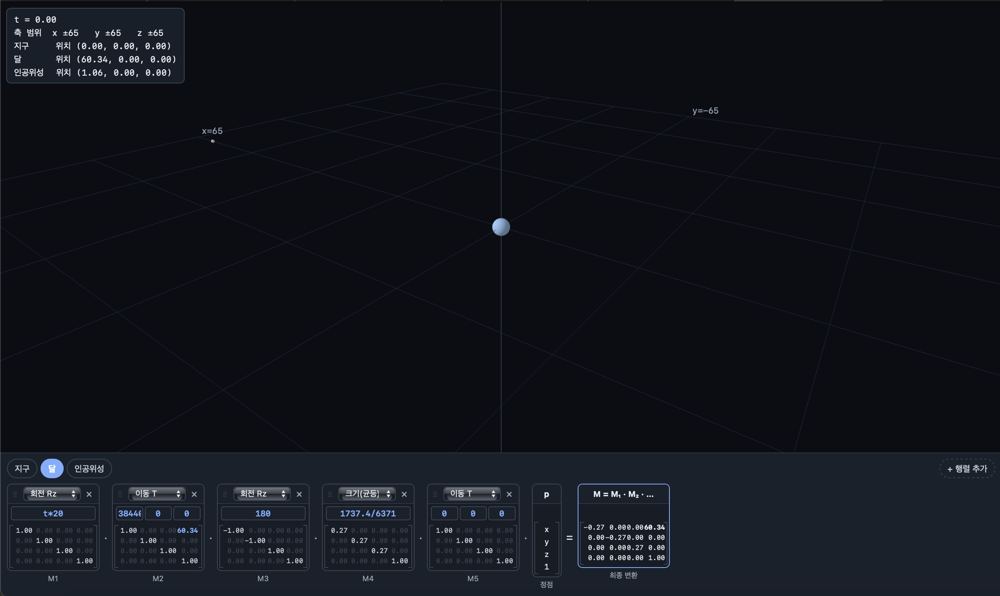
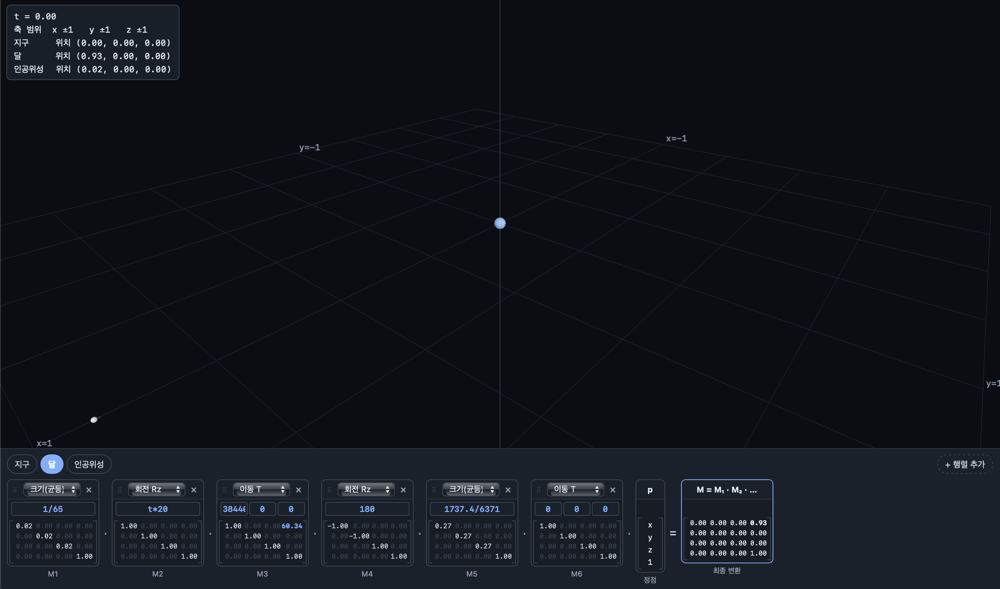
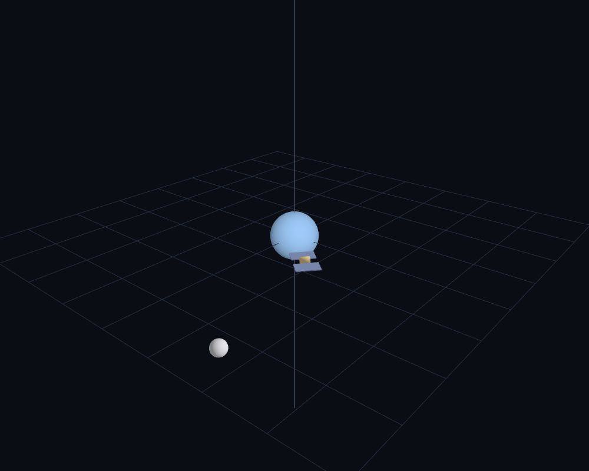

# 2주차 과제 — 지구·달·인공위성 변환 설계

| Task | 결과 페이지 (GitHub Pages) | 실습 도구 설정 |
| --- | --- | --- |
| Task 1 | [task1.html](https://yeonynywhat.github.io/computerGraphics/week2/task1.html) | [설정 다시 열기](https://cg.catholic.ac.kr/~mgchoi/CG/demos/d02-transform-lab.html?d=eyJyYW5nZSI6eyJ4IjoiNjUiLCJ5IjoiNjUiLCJ6IjoiNjUifSwib2JqZWN0cyI6W3siaWQiOiJlYXJ0aCIsIm5hbWUiOiLsp4DqtawiLCJjb2xvciI6WzAuMzUsMC42LDAuOTVdLCJzdGVwcyI6W119LHsiaWQiOiJtb29uIiwibmFtZSI6IuuLrCIsImNvbG9yIjpbMC43OCwwLjc4LDAuODJdLCJzdGVwcyI6W3sidHlwZSI6IlJ6IiwiYXJncyI6WyJ0KjIwIl19LHsidHlwZSI6IlQiLCJhcmdzIjpbIjM4NDQwMC82MzcxIiwiMCIsIjAiXX0seyJ0eXBlIjoiUnoiLCJhcmdzIjpbIjE4MCJdfSx7InR5cGUiOiJTdSIsImFyZ3MiOlsiMTczNy40LzYzNzEiXX0seyJ0eXBlIjoiVCIsImFyZ3MiOlsiMCIsIjAiLCIwIl19XX0seyJpZCI6InNhdCIsIm5hbWUiOiLsnbjqs7XsnITshLEiLCJjb2xvciI6WzAuOTUsMC43MiwwLjM1XSwic3RlcHMiOlt7InR5cGUiOiJSeiIsImFyZ3MiOlsidCo0MCJdfSx7InR5cGUiOiJUIiwiYXJncyI6WyIoNjM3MSs0MDApLzYzNzEiLCIwIiwiMCJdfSx7InR5cGUiOiJSeiIsImFyZ3MiOlsiMTgwIl19LHsidHlwZSI6IlN1IiwiYXJncyI6WyIxMDkvKDYzNzEwMDAqNS4yKSJdfV19XX0%3D) |
| Task 2 | [task2.html](https://yeonynywhat.github.io/computerGraphics/week2/task2.html) | [설정 다시 열기](https://cg.catholic.ac.kr/~mgchoi/CG/demos/d02-transform-lab.html?d=eyJyYW5nZSI6eyJ4IjoiMSIsInkiOiIxIiwieiI6IjEifSwib2JqZWN0cyI6W3siaWQiOiJlYXJ0aCIsIm5hbWUiOiLsp4DqtawiLCJjb2xvciI6WzAuMzUsMC42LDAuOTVdLCJzdGVwcyI6W3sidHlwZSI6IlN1IiwiYXJncyI6WyIxLzY1Il19XX0seyJpZCI6Im1vb24iLCJuYW1lIjoi64usIiwiY29sb3IiOlswLjc4LDAuNzgsMC44Ml0sInN0ZXBzIjpbeyJ0eXBlIjoiU3UiLCJhcmdzIjpbIjEvNjUiXX0seyJ0eXBlIjoiUnoiLCJhcmdzIjpbInQqMjAiXX0seyJ0eXBlIjoiVCIsImFyZ3MiOlsiMzg0NDAwLzYzNzEiLCIwIiwiMCJdfSx7InR5cGUiOiJSeiIsImFyZ3MiOlsiMTgwIl19LHsidHlwZSI6IlN1IiwiYXJncyI6WyIxNzM3LjQvNjM3MSJdfSx7InR5cGUiOiJUIiwiYXJncyI6WyIwIiwiMCIsIjAiXX1dfSx7ImlkIjoic2F0IiwibmFtZSI6IuyduOqzteychOyEsSIsImNvbG9yIjpbMC45NSwwLjcyLDAuMzVdLCJzdGVwcyI6W3sidHlwZSI6IlN1IiwiYXJncyI6WyIxLzY1Il19LHsidHlwZSI6IlJ6IiwiYXJncyI6WyJ0KjQwIl19LHsidHlwZSI6IlQiLCJhcmdzIjpbIig2MzcxKzQwMCkvNjM3MSIsIjAiLCIwIl19LHsidHlwZSI6IlJ6IiwiYXJncyI6WyIxODAiXX0seyJ0eXBlIjoiU3UiLCJhcmdzIjpbIjEwOS8oNjM3MTAwMCo1LjIpIl19XX1dfQ%3D%3D) |
| Task 3 | [task3.html](https://yeonynywhat.github.io/computerGraphics/week2/task3.html) | [설정 다시 열기](https://cg.catholic.ac.kr/~mgchoi/CG/demos/d02-transform-lab.html?d=eyJyYW5nZSI6eyJ4IjoiMSIsInkiOiIxIiwieiI6IjEifSwib2JqZWN0cyI6W3siaWQiOiJlYXJ0aCIsIm5hbWUiOiLsp4DqtawiLCJjb2xvciI6WzAuMzUsMC42LDAuOTVdLCJzdGVwcyI6W3sidHlwZSI6IlN1IiwiYXJncyI6WyIxLzkiXX1dfSx7ImlkIjoibW9vbiIsIm5hbWUiOiLri6wiLCJjb2xvciI6WzAuNzgsMC43OCwwLjgyXSwic3RlcHMiOlt7InR5cGUiOiJTdSIsImFyZ3MiOlsiMS85Il19LHsidHlwZSI6IlJ6IiwiYXJncyI6WyJ0KjIwIl19LHsidHlwZSI6IlQiLCJhcmdzIjpbIjguMTU1MyIsIjAiLCIwIl19LHsidHlwZSI6IlJ6IiwiYXJncyI6WyIxODAiXX0seyJ0eXBlIjoiU3UiLCJhcmdzIjpbIjE3MzcuNC82MzcxIl19XX0seyJpZCI6InNhdCIsIm5hbWUiOiLsnbjqs7XsnITshLEiLCJjb2xvciI6WzAuOTUsMC43MiwwLjM1XSwic3RlcHMiOlt7InR5cGUiOiJTdSIsImFyZ3MiOlsiMS85Il19LHsidHlwZSI6IlJ6IiwiYXJncyI6WyJ0KjQwIl19LHsidHlwZSI6IlQiLCJhcmdzIjpbIjIuMzk3OSIsIjAiLCIwIl19LHsidHlwZSI6IlJ6IiwiYXJncyI6WyIxODAiXX0seyJ0eXBlIjoiU3UiLCJhcmdzIjpbIjAuMyJdfV19XX0%3D) |

> 행렬은 오른쪽부터 적용된다. 아래 변환식 `A · B · C`는 정점에 C → B → A 순서로 작용한다.

---

## Task 1 — 실제 비율로 만들기

### 사용한 실제 수치와 변환

대상 인공위성은 국제우주정거장(ISS)으로 정했다. 조사한 실제 수치는 다음과 같다(출처는 문서 맨 아래).

| 대상 | 항목 | 값 |
| --- | --- | --- |
| 지구 | 평균 반지름 | 6,371 km |
| 달 | 평균 반지름 | 1,737.4 km |
| 달 | 지구 중심에서의 평균 거리 | 384,400 km |
| ISS | 고도 | 약 400 km (보통 400~430 km 사이에서 변함) |
| ISS | 궤도 반지름 | 6,371 + 400 = 약 6,771 km |
| ISS | 크기 (전체 길이) | 약 109 m |
| ISS | 궤도 경사각 | 51.6° |
| ISS | 공전 주기 | 약 90~93분 (하루 약 15.5~16바퀴) |

ISS의 고도는 대기 저항으로 조금씩 낮아졌다가 주기적으로 다시 높여지므로, 대표값 400 km를 사용했다. 궤도 경사각은 궤도면이 적도와 이루는 각으로, ISS는 북위·남위 51.6° 사이를 지난다. 이번 실습은 지구의 xy 평면 위에서 도는 2D 공전으로 단순화했기 때문에 경사각은 변환에 반영하지 않았다.

지구 반지름을 1단위로 두고 다음과 같이 변환했다.

| 물체 | 크기 배율 | 지구 중심에서의 거리 |
| --- | --- | --- |
| 지구 | 1 | 0 |
| 달 | `1737.4/6371` ≈ 0.273 | `384400/6371` ≈ 60.34 |
| ISS | `109/(6371000*5.2)` ≈ 0.0000033 | `(6371+400)/6371` ≈ 1.0628 |

```
달  : Rz(t·20°) · T(60.34, 0, 0) · Rz(180°) · S(0.273)
ISS : Rz(t·40°) · T(1.0628, 0, 0) · Rz(180°) · S(109/(6371000·5.2))
```

ISS는 데모 모형의 전체 x축 길이(패널 끝에서 끝까지)가 5.2단위이므로, 109 m를 지구 반지름 단위로 바꾼 값을 5.2로 나누어 배율을 계산했다. 이렇게 하면 모형의 전체 길이가 정확히 109 m가 된다. ISS의 실제 형상을 정밀하게 재현한 것은 아니며, 대표 길이를 기준으로 비율을 맞춘 것이다.

### 1. 거리의 단위를 무엇으로 정했는가? 왜 그렇게 정했는가?

지구 반지름 6,371 km를 1단위로 정했다. 지구를 기준으로 달과 ISS의 크기 및 거리를 같은 비율로 표현하기 위해서다. km나 m를 그대로 사용하면 숫자가 너무 커지므로, 지구 반지름으로 나누어 다루기 쉬운 값(약 0.0000033 ~ 60)으로 만들었다.

### 2. 숫자가 커서 생긴 문제가 있었는가? 있었다면 무엇인가?

있었다. 달의 실제 거리를 적용하자 지구에서 약 60.34단위 떨어져 기본 축 범위 밖으로 나갔다. 이를 확인하기 위해 축 범위를 65로 늘렸다(달 중심 60.34 + 달 반지름 0.27 ≈ 60.6보다 조금 크게).

반대로 ISS는 실제 크기 배율이 약 0.0000033으로 매우 작아서 화면에서 보이지 않았다. 계산하면 화면에서 1픽셀보다 훨씬 작다. 방향을 확인할 때만 크기를 임시로 0.15로 키웠고, 확인 후 실제 비율로 되돌렸다. 실제 비율에서는 지구·달·ISS를 모두 보기 쉽게 표현하기 어렵다는 점을 확인했다.

정밀도 측면에서, GPU가 쓰는 float32는 유효숫자가 약 7자리다. 만약 m 단위를 썼다면 달 거리 384,400,000 m는 9자리라 끝자리를 정확히 표현할 수 없고(약 수십 m 단위로 반올림), 같은 장면에 109 m짜리 물체를 함께 다루면 오차가 물체 크기와 비슷해질 수 있다. 지구 반지름 단위를 쓰면 위치 값이 1~60 정도라 이런 문제가 생기지 않는다. 이것도 단위를 지구 반지름으로 정한 이유다.

### 3. 달·위성이 지구를 향하게 만든 것은 어느 변환 단계 덕분인가?

이동 T와 크기 S 사이에 넣은 회전 `Rz(180°)`가 기본 방향을 지구 쪽으로 보정했다. 달과 ISS가 지구의 +X 방향에 있을 때 로컬 +X 방향을 −X 방향(지구 쪽)으로 돌린 것이다.

또한 맨 왼쪽의 공전 회전 `Rz(t)`가 이동 T보다 왼쪽에 있어서, 위치와 함께 물체의 로컬 좌표축까지 회전시킨다. 그래서 공전 중에도 같은 면이 계속 지구를 향한다(조석 고정). 순서를 바꿔 `T · Rz(t)`로 쓰면 물체는 제자리에서 자전만 한다. 행렬은 오른쪽부터 적용되므로 크기 조절 → 방향 보정 → 궤도 거리로 이동 → 공전 순서로 작동한다.

두 공전 속도(달 20°/t, ISS 40°/t)는 실제 공전주기가 아니라 실습에서 움직임을 확인하기 위한 값이다. 실제로는 ISS가 약 93분, 달이 약 27.3일에 한 바퀴를 돌아 약 400배 차이가 나며, 이 비율을 그대로 쓰면 달이 멈춰 보인다.



---

## Task 2 — NDC 범위에 맞추기

```
지구 : S(1/65)
달   : S(1/65) · Rz(t·20°) · T(60.34, 0, 0) · Rz(180°) · S(0.273)
ISS  : S(1/65) · Rz(t·40°) · T(1.0628, 0, 0) · Rz(180°) · S(109/(6371000·5.2))
```

### 1. s 를 얼마로 정했고 그 값을 어떻게 계산했는가?

`s = 1/65`(≈ 0.0154)로 정했다. 화면에 보이는 범위는 [−1, 1]이므로, 장면에서 가장 먼 점이 1 안에 들어오도록 그 거리보다 조금 큰 값으로 나누었다.

- 가장 먼 점 = 달 중심 거리 + 달 반지름 = 60.34 + 0.27 ≈ 60.6
- 60.6으로 나누면 달 끝이 화면 가장자리에 딱 붙으므로, 여유를 두어 65로 나누었다 (60.6 / 65 ≈ 0.93).
- 65는 Task 1에서 축 범위로 쓴 값과 같아, Task 1의 화면을 그대로 [−1, 1]로 옮긴 것과 같다.

Task 1에서 만든 지구·달·ISS의 변환을 유지하고, 세 물체의 변환 행렬 **맨 왼쪽**에 균등 스케일 `s = 1/65`를 추가했다.

도구에서는 물체마다 각각 입력했지만, 세 물체에 동일한 배율을 적용했으므로 장면 전체에 공통 스케일을 적용한 것과 같다. 맨 왼쪽은 정점에 가장 마지막으로 적용되므로, 이미 이동까지 끝난 월드 좌표 전체를 축소한다. 그래서 크기뿐 아니라 이동 거리도 함께 줄어든다. 만약 맨 오른쪽에 넣었다면 물체 크기만 줄고 이동 거리 60.34는 그대로라 달이 화면 밖으로 나간다. 달과 ISS의 공전 회전 및 방향 보정 행렬은 그대로 유지했다.

### 2. 세 물체가 모두 화면 안에 보이는지 확인하고, 그 화면을 캡처하세요.

축 범위를 x·y·z 모두 1로 설정하고 확인했다. 세 물체의 **위치**는 모두 [−1, 1] 안에 들어왔다. 지구는 가운데, 달은 오른쪽 끝 가까이(약 0.93)를 돈다. 다만 크기가 매우 작아, 달은 작은 점으로 보이고 ISS는 화면에서 보이지 않았다.



### 3. 비율을 유지한 결과, 화면에서 지구와 인공위성은 어떻게 보이는가?

모든 물체의 크기와 거리에 동일한 `1/65`를 적용했으므로 실제 비율은 그대로 유지된다. 물체마다 다른 값을 쓰면 이 비율이 깨진다.

그 결과 **지구**는 화면 가운데 반지름 약 0.015의 아주 작은 구로 보였다. **ISS**는 지구 중심에서 약 0.016 떨어진, 즉 지구 표면에 거의 붙은 위치를 돌고, 크기는 약 0.00000005로 1픽셀보다 훨씬 작아 화면에서 전혀 구분할 수 없었다. 지구와 ISS의 거리(표면에서 400 km)는 지구 반지름의 약 6%밖에 되지 않아, 크기를 키우더라도 지구에 붙어 보였을 것이다.

이를 통해 실제 비율을 유지하는 것과 모든 물체를 알아보기 쉽게 표현하는 것은 서로 다른 문제임을 확인했다. 이것이 Task 3에서 표현 방식을 바꾼 이유다.

---

## Task 3 — 보는 사람을 위한 표현

### 1. 실제 비율이 정보를 전달하기에 적합한가? 그 이유는?

적합하지 않다고 판단했다. 실제 비율은 크기와 거리를 정확하게 담고 있지만, Task 2 화면에서는 달이 점처럼 보이고 ISS는 아예 보이지 않았다. 원인은 두 거리의 차이다. ISS 고도(400 km)와 달 거리(약 38만 km)는 약 1000배 차이가 나서, 선형 축척으로는 ISS가 지구에 붙어 보이거나 달이 화면 밖으로 나간다. 그래서 이번에는 실제 크기의 정확성보다 세 물체를 한 화면에서 알아보고 위치·공전 관계를 이해하는 것을 우선했다.

### 2. 더 나은 표현 방법을 제안하고 실제로 만들기

**로그 거리 + 위성 크기 과장**을 선택했다.

거리는 지표면에서 잰 고도 h(km)를 다음 식으로 바꿔서 사용했다(단위: 지구 반지름).

```
표시 거리 = 1 + 2 · log10(1 + h / 100)
```

- `1 +` : 지구 반지름. 고도 0이면 지표면이므로 어떤 물체도 지구 안으로 들어가지 않는다.
- `h / 100` : 100 km는 흔히 우주의 경계로 쓰는 고도(카르만 선)다. 고도를 "우주 경계 고도의 몇 배인가"로 읽을 수 있다.
- `log10` : 약 1000배 차이 나는 두 거리를 압축해 한 화면에 담는다. 가깝고 먼 순서는 그대로 유지된다.
- `1 + h/100`의 1 : h = 0일 때 log 값이 0이 되게 한다(없으면 −∞).
- `2 ·` : 간격이 화면에서 적당히 보이도록 정한 배율.

```
지구 : S(1/9)
달   : S(1/9) · Rz(t·20°) · T(8.155, 0, 0) · Rz(180°) · S(0.273)
ISS  : S(1/9) · Rz(t·40°) · T(2.398, 0, 0) · Rz(180°) · S(0.3)
```

| 물체 | 표시 거리 | 크기 | Task 2 대비 |
| --- | --- | --- | --- |
| 지구 | 0 | 반지름 1 | 그대로 |
| ISS | 1 + 2·log10(5) ≈ 2.398 | 0.3배 (폭 1.56) | 거리 로그 변환, 크기 크게 과장 |
| 달 | 1 + 2·log10(3781.3) ≈ 8.155 | 0.273배 (실제 비율) | 거리 로그 변환, 크기 실제 비율 유지 |

- **크기:** 거리를 압축하니 달은 실제 크기 비율 그대로도 잘 보여서, 지구:달 = 1 : 0.273을 유지했다. ISS는 실제 크기(109 m)로는 절대 보이지 않으므로 0.3배(폭 1.56)로 과장했다. 처음에는 0.1배로 했지만 화면에서 몇 픽셀밖에 되지 않아 0.3배로 키웠다. 패널은 궤도 반지름 2.398을 중심으로 1.62~3.18 범위에 있으므로 지구(반지름 1)와 겹치지 않는다.
- **화면 맞춤:** 가장 먼 점이 달 중심 8.155 + 달 반지름 0.273 ≈ 8.43이므로, Task 2와 같은 원리로 맨 왼쪽에 공통 스케일 `1/9`을 넣었다.
- **방향:** `Rz(t) · T · Rz(180°)` 구조는 그대로 유지해 달과 ISS가 계속 지구를 향한다.
- **카메라:** 축 범위 1에 맞춘 장면이 기본 카메라 거리(9)에서는 너무 작게 보여, `task3.html`에서 처음 화면의 카메라 거리를 2.6으로 줄여 세 물체가 바로 보이도록 했다. 변환 행렬과는 무관한 보기 설정이다(실습 도구 링크에는 이 설정이 저장되지 않는다).

> 이전 버전에서는 크기만 과장했다(달 4배, ISS 0.5배). 그 결과 달이 지구보다 커지고, ISS 패널이 지구를 뚫고 들어가는 문제가 있어 위 방식으로 바꿨다.

### 3. 제안한 방법의 장점과 잃는 점

**장점**
- 지구, ISS, 달이 한 화면에서 모두 식별된다.
- "ISS는 지구에 아주 가깝고 달은 훨씬 멀다"는 순서와 관계가 유지된다.
- 지구와 달의 크기 비율은 실제와 같다.
- 공식으로 거리를 정했으므로 다른 위성(예: 정지궤도 위성, 고도 35,786 km)도 같은 규칙으로 추가할 수 있다.

**잃는 점**
- 거리 비율이 왜곡된다. 실제로 달은 ISS보다 약 57배 멀지만(궤도 반지름 기준) 화면에서는 약 3.4배로 보인다.
- 로그 축이라 화면 거리로 실제 거리를 잴 수 없다(스케일 바를 쓸 수 없다).
- ISS 크기는 실제와 전혀 다르고, 공전 속도 비율(실제 약 400배)도 보기 쉽게 바꿨다.
- 따라서 이 그림은 "정확한 축척 모형"이 아니라 "위치 관계와 궤도 구조를 보여 주는 모형"이라고 설명해야 한다.



---

## 결론

Task 1·2에서 실제 비율을 그대로 쓰면 정확하지만 보는 사람이 알아볼 수 없다는 것을 확인했다. Task 3에서는 거리를 로그로 압축하고 위성 크기만 과장해, 정확성 일부를 포기하는 대신 세 물체의 위치와 공전 관계를 한 화면에서 전달했다. 그래픽스에서는 수치를 실제와 같게 만드는 것뿐 아니라, 무엇을 전달하려는지에 따라 표현 방법을 선택하고 그 대가를 밝히는 것이 중요하다.

---

## 자료 출처

- 지구·달 반지름, 달 공전 궤도: [NASA Moon Fact Sheet](https://nssdc.gsfc.nasa.gov/planetary/factsheet/moonfact.html)
- 달 평균 거리 384,400 km: [NASA Science — Moon Facts](https://science.nasa.gov/moon/facts/)
- ISS 전체 길이 109 m: [NASA — Space Station Facts and Figures](https://www.nasa.gov/international-space-station/space-station-facts-and-figures/)
- ISS 평균 고도 약 400 km: [International Space Station — Wikipedia](https://en.wikipedia.org/wiki/International_Space_Station)
- ISS 궤도 경사각 51.6°, 공전 주기 90~93분: [NASA Johnson Space Center — Space Station Orbit Tutorial](https://eol.jsc.nasa.gov/Tools/orbitTutorial.htm)
