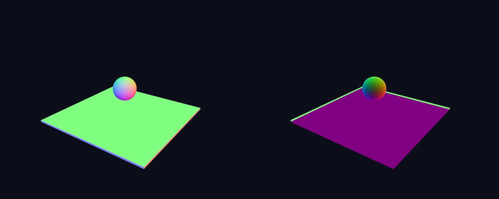
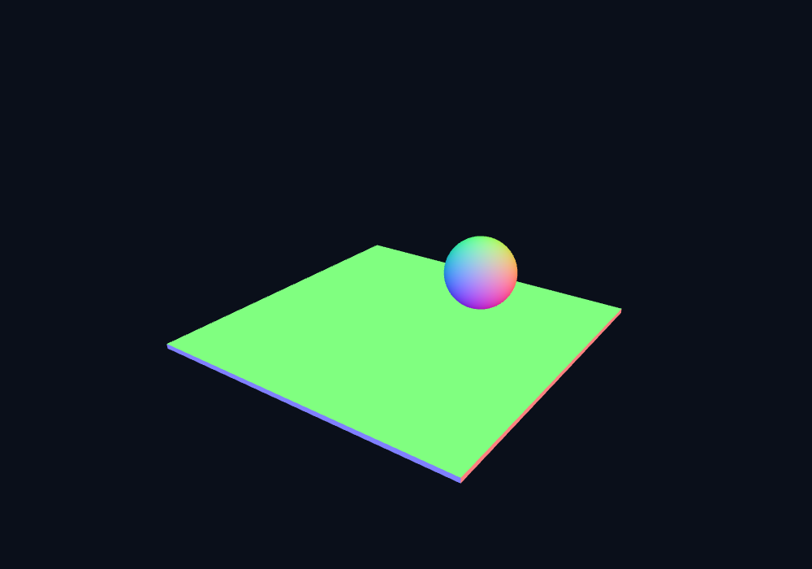
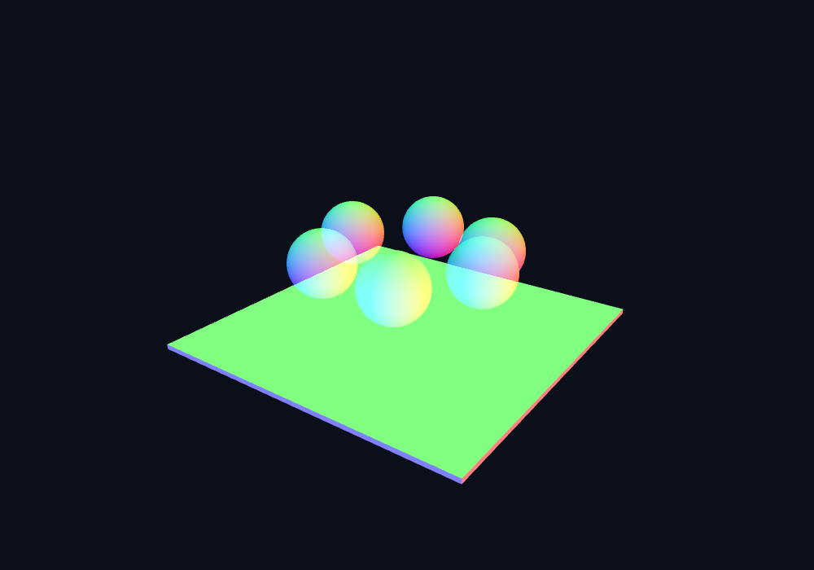
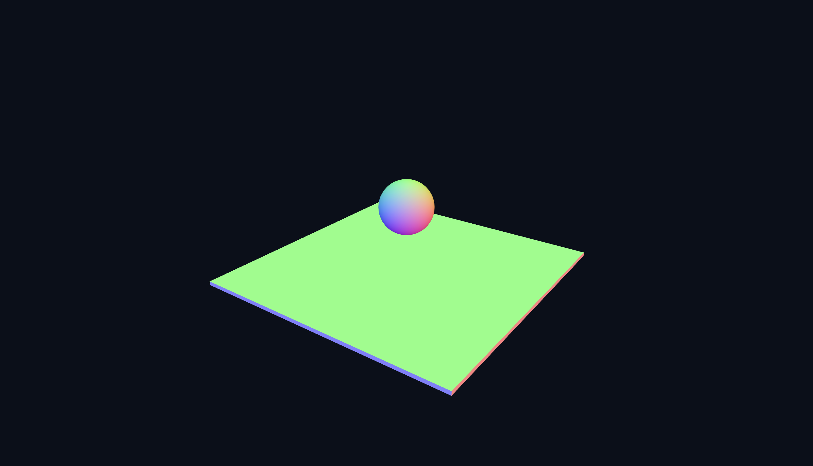
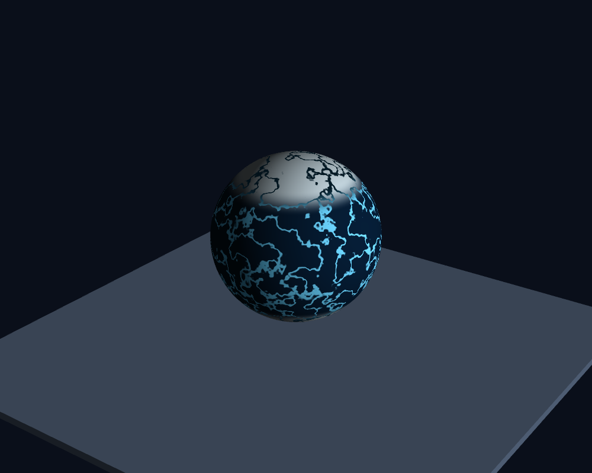
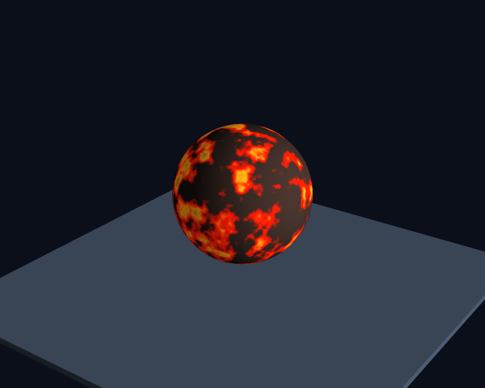
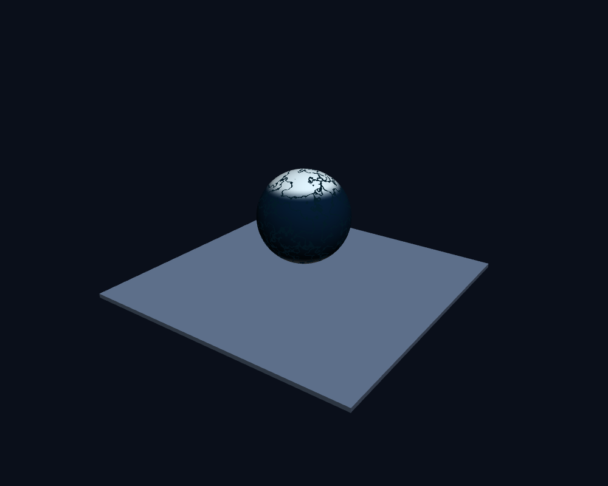
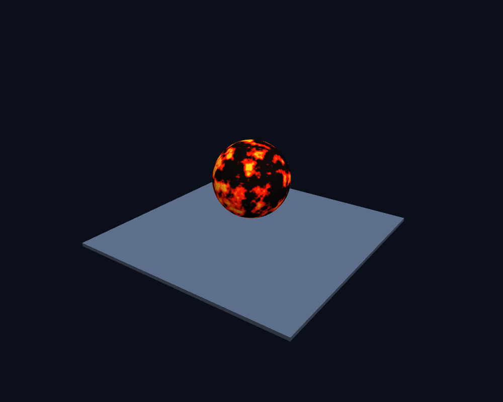

# 3주차 실습 보고서 — 그래픽스 파이프라인과 셰이더

## 1. 실습 목적

제공된 `w3-start.html`의 삼각형 그리기 프로그램을 단계별로 수정하여, 바닥 위에 공이 떠서 회전하는 3차원 장면을 만든다. 이 과정에서 메시 데이터, 버텍스 셰이더, 프래그먼트 셰이더, 행렬, 그리기 루프가 어떻게 연결되는지 살펴본다.

이후 프래그먼트 셰이더를 변경하면서 픽셀의 색을 계산하는 방식에 따라 화면이 어떻게 달라지는지 관찰한다.

## 2. 실행 링크

- 실습 1: [task1.html 실행](https://yeonynywhat.github.io/computerGraphics/week3/task1.html)
- 실습 2: [task2.html 실행](https://yeonynywhat.github.io/computerGraphics/week3/task2.html)
- 실습 2-1 : [task3.html 실행](https://yeonynywhat.github.io/computerGraphics/week3/task3.html)

## 3. 실습 1 — 바닥 위에 떠서 회전하는 공

### 3.1. 출발 코드의 구조

출발 파일은 다음 여섯 구역으로 구성되어 있다.

| 구역 | 역할 |
| --- | --- |
| 메시 데이터 | 정점 위치, 법선, 색, 삼각형의 연결 순서를 정의한다. |
| 버텍스 셰이더 | 정점의 위치를 변환하고 색과 법선을 다음 단계로 전달한다. |
| 프래그먼트 셰이더 | 보간된 입력을 이용해 화면에 출력할 색을 계산한다. |
| WebGL 준비 | 셰이더를 컴파일하고 하나의 프로그램으로 연결한다. |
| 버퍼 만들기 | 메시 데이터를 GPU 메모리에 전달하고 읽는 방식을 설정한다. |
| 그리기 루프 | 매 프레임 화면을 지우고 필요한 값을 전달한 뒤 물체를 그린다. |

JavaScript로 작성된 준비 과정과 그리기 루프는 CPU에서 실행된다. `VS_SOURCE`와 `FS_SOURCE`에 작성된 GLSL 셰이더는 GPU에서 실행된다.

삼각형의 색은 꼭짓점 세 곳에만 지정되어 있지만, 래스터화 단계에서 그 사이의 값이 보간되므로 내부에 부드러운 색 변화가 나타난다.

### 3.2. 단계별 구현 내용

#### 깊이 테스트

`render()` 안에 다음 코드를 추가했다.

```js
gl.enable(gl.DEPTH_TEST);
```

깊이 테스트는 같은 화면 위치에 여러 면이 겹칠 때 깊이를 비교하여 앞쪽 면이 보이도록 한다.

깊이 테스트를 끄면 앞뒤 거리 대신 그려지는 순서에 따라 나중에 그린 면이 앞의 면을 덮는다. 이를 확인하기 위해 `gl.enable(gl.DEPTH_TEST)`를 `gl.disable(gl.DEPTH_TEST)`로 바꿔 실행했다(왼쪽: 켬, 오른쪽: 끔).



깊이 테스트를 끄자 바닥 상자의 **아랫면**(법선이 −y라 보라색)이 윗면(초록)을 덮었고, 공도 뒤쪽 면의 색이 앞으로 나와 어둡게 보였다. 상자의 아랫면이 윗면보다 나중에 그려지기 때문이다. 법선을 색으로 표시한 셰이더를 쓰고 있어서, 어느 면이 앞에 그려졌는지 색으로 바로 구분할 수 있었다.

#### 바닥과 구의 메시

기존 삼각형의 배열을 `makeBox()`와 `makeSphere()` 함수로 교체했다.

`makeBox()`는 면마다 위치와 법선을 지정하여 상자를 만든다. 바닥은 높이가 작은 납작한 상자로 표현한다.

`makeSphere()`는 위도와 경도를 따라 정점을 만들고, 이웃한 정점들을 삼각형으로 연결한다. 구의 중심에서 표면을 향하는 방향을 법선으로 사용한다.

#### 행렬과 버텍스 셰이더

버텍스 셰이더에 `uModel`과 `uViewProj`를 추가했다.

```glsl
vNormal = mat3(uModel) * aNormal;
gl_Position = uViewProj * uModel * vec4(aPos, 1.0);
```

행렬은 오른쪽부터 적용된다. 정점을 먼저 모델 행렬로 세계 속에 배치하고, 그다음 카메라와 원근 변환을 적용한다.

법선은 방향을 나타내므로 이동 성분을 제외한 `mat3(uModel)`을 사용한다. 이번 장면에서는 물체가 회전할 때 법선도 함께 회전하도록 한다.

#### 카메라와 그리기 루프

이동, 회전, 원근, 크기 변환을 순서대로 쌓아 대각선 위에서 장면을 내려다보는 카메라 행렬을 구성했다.

그리기 루프에서는 바닥과 공에 각각 다른 모델 행렬을 전달한다. 공은 시간에 따라 y축으로 회전시키고, 위로 이동시켜 바닥에서 떨어져 있도록 배치한다.

### 3.3. 행렬 곱 순서 비교

변경 전 코드는 다음과 같다.

```js
const model = M4.multiply(
  M4.translate(0, 1.9, 0),
  M4.rotateY(time * 0.8)
);
```

오른쪽의 회전을 먼저 적용한 뒤, y축 방향으로 1.9만큼 이동한다.

변경 후 코드는 다음과 같다.

```js
const model = M4.multiply(
  M4.rotateY(time * 0.8),
  M4.translate(0, 1.9, 0)
);
```

오른쪽의 이동을 먼저 적용한 뒤, y축을 기준으로 회전한다.

**계산에 따른 예상**

일반적으로 행렬의 곱 순서를 바꾸면 결과가 달라진다. 그러나 이 예제에서는 이동 방향과 회전축이 모두 y축이다. 공의 중심 `(0, 1.9, 0)`은 y축 위에 있으므로 y축으로 회전해도 위치가 변하지 않는다. 따라서 두 식은 같은 결과를 만들며, 이 상태에서는 순서를 바꿔도 공전이 생기지 않는다. 실제로 두 순서로 실행한 화면이 같았다.

**추가 실험: 이동에 x 성분 넣기**

차이를 눈으로 확인하기 위해 이동을 `T(2, 1.9, 0)`으로 바꿔 두 순서를 다시 실행했다. 회전축(y축)에서 x 방향으로 2만큼 떨어뜨린 것이다.

```js
// (가) T · Ry : 먼저 제자리에서 돌고, 그다음 (2, 1.9, 0)으로 이동 → 자전
M4.multiply(M4.translate(2, 1.9, 0), M4.rotateY(time * 0.8));

// (나) Ry · T : 먼저 (2, 1.9, 0)으로 이동하고, 그다음 원점의 y축을 기준으로 회전 → 공전
M4.multiply(M4.rotateY(time * 0.8), M4.translate(2, 1.9, 0));
```

움직임을 한 장에 담기 위해 약 1.3초 간격으로 찍은 화면 6장을 겹쳤다.

| (가) `T · Ry` — 자전 | (나) `Ry · T` — 공전 |
| --- | --- |
|  |  |

(가)에서는 공이 한 자리에 머물러 6장이 한 개로 겹쳤다. (나)에서는 이동된 중심까지 함께 회전해 공이 y축 둘레의 원을 따라 여러 위치에 찍혔다. 행렬은 오른쪽부터 적용되므로, 회전이 이동보다 나중(왼쪽)에 오면 이동된 위치까지 회전시킨다는 것을 확인했다. 원래 코드에서 차이가 없었던 이유는 회전 중심과 물체 중심이 같은 축 위에 있었기 때문이다.

### 3.4. 프래그먼트 셰이더 변경 실험

- 선택한 실습실 예제: 법선을 색으로 표현하기
현재 저장한 `task1.html`의 프래그먼트 셰이더는 다음과 같다.

```glsl
#version 300 es
precision highp float;                // 실수 정밀도 선언 — 여기서는 필수입니다

in vec3 vColor;                       // 버텍스 셰이더가 보낸 값이 "보간되어" 들어온다
in vec3 vNormal;

uniform float uTime;

out vec4 fragColor;                   // 이 픽셀의 최종 색

void main() {
  vec3 N = normalize(vNormal);
  fragColor = vec4(N * 0.5 + 0.5, 1.0);
}
```
- 실행 화면




**관찰 결과와 원리**

셰이더를 변경한 뒤 구의 표면이 알록달록한 색으로 표시되었다. 처음에는 색판처럼 보이는 결과가 의도한 것인지 확인했지만, 법선 방향을 색으로 나타내는 실험이라는 점을 이해했다. 기존 정점 색이나 확산 조명의 밝기를 보여주는 대신 표면이 향하는 방향을 직접 색으로 표현한 결과이다.

`normalize(vNormal)`은 보간된 법선의 길이를 1로 맞춘다. 그 성분은 -1~1 범위이므로 `N * 0.5 + 0.5`를 적용하면 색에 사용할 수 있는 0~1 범위로 옮겨진다. x, y, z 성분은 각각 빨강, 초록, 파랑에 대응한다. 구는 표면 방향이 연속적으로 달라져 색도 부드럽게 변하지만, 바닥용 상자는 한 면의 법선이 일정하므로 면마다 일정한 색이 나온다. 이 셰이더에서는 조명의 내적을 사용하지 않는다.

### 3.5. 구현 중 확인한 점

카메라 행렬을 계산하는 코드와 물체를 그리는 코드는 `render()` 안에 들어간다. 반면 `M4.rotateX()` 등 행렬을 만드는 도구 함수는 `render()` 밖에 정의한다.

또한 버텍스 셰이더를 수정할 때는 기존 위치 계산을 새 계산으로 교체해야 한다. 기존 `gl_Position` 대입문과 닫는 중괄호가 중복으로 남지 않도록 확인해야 한다.

## 4. 실습 2 — 얼음 균열 행성과 용암 행성

### 4.1. 제작 의도

차가운 얼음과 뜨거운 용암을 대비시켜, 서로 다른 모습으로 내부 에너지를 드러내는 두 행성을 만들고자 했다.
얼음 행성은 짙은 푸른 표면과 하얀 극관으로 차가운 느낌을 주고, 균열에서 푸른빛이 맥동하도록 설계했다.
용암 행성은 검은 암석 사이에 붉고 노란 용암 지대를 배치하여 아직 식지 않은 젊은 행성을 표현했다.

수업 예제에서 다룬 절차적 잡음과 색 혼합 기법을 활용하되, 가스 행성의 띠나 위성의 분화구 대신 얼음의 가느다란 균열과 넓은 용암 영역을 주요 무늬로 삼았다.
두 행성은 색만 다르게 한 것이 아니라, 같은 잡음 값을 선 모양으로 선택하는 방식과 영역으로 선택하는 방식을 각각 사용했다.

### 4.2. 공통 구현 구조

실습 1의 바닥, 카메라, 행렬 도구와 그리기 루프를 유지하고, 반지름 1.3인 구를 위도 64칸, 경도 128칸으로 나누었다.
얼음 행성은 `task2.html`, 용암 행성은 `task3.html`에 구현했다.
표면의 무늬는 이미지 파일을 읽지 않고 프래그먼트 셰이더에서 계산했다. 아래 보고서의 PNG 파일은 결과 캡처이며 렌더링용 텍스처가 아니다.

버텍스 셰이더에서 `vSurf = aNormal`로 회전 전 물체 기준 법선을 전달하고, `vNormal = mat3(uModel) * aNormal`로 세계 기준 법선을 전달한다.
프래그먼트 셰이더에서는 두 값을 다시 정규화한다. 무늬는 `vSurf`로 계산하므로 표면에 붙어서 자전하고, 조명은 `vNormal`로 계산하므로 고정된 광원에 대한 방향을 반영한다.
`uIsPlanet`을 바닥에는 0, 행성에는 1로 전달하여 행성 무늬와 발광이 바닥에 적용되지 않도록 했다.

과제 안내에 따라 카메라가 행성을 가까이에서 가운데에 보도록 바꿨다. 카메라의 첫 단계에서 바라보는 점을 바닥 근처(`y = 1.1`)에서 행성 중심(`y = 1.9`)으로 옮겼다. 또 마지막 크기 조절 `scale(1 / 3.4, …)`를 `scale(1 / 1.8, …)`로 바꿔 보이는 범위를 좁혔다. 그 결과 행성이 화면 가운데에 더 크게 보인다.

두 파일의 잡음 함수는 같다. `hash31`은 좌표마다 일정한 의사 난수를 만들고, `noise3`는 주변 격자 꼭짓점 8개의 값을 부드럽게 보간한다.
`fbm`은 주파수를 두 배, 진폭을 절반으로 바꾸며 잡음 4겹을 합친다. 마지막에 진폭의 합으로 나누어 값을 정규화한다.

### 4.3. 얼음 행성 — 계산식과 표현 방법

#### 하얀 극관

```glsl
float polar = smoothstep(0.6, 0.8, abs(S.y));
vec3 surfaceColor = mix(baseColor, iceColor, polar);
```

정규화한 구의 방향 `S`에서 `S.y`는 북극에서 1, 적도에서 0, 남극에서 -1이다.
`abs`를 사용해 남극과 북극을 같은 조건으로 처리한다.
절댓값이 0.6 이하이면 기본색, 0.8 이상이면 얼음색이 되며, 사이에서는 부드럽게 섞인다.
따라서 경계가 날카롭게 끊기지 않는 하얀 극관이 만들어진다.

#### 불규칙한 균열

```glsl
float h = fbm(S * 5.0);
float crack = 1.0 - smoothstep(0.015, 0.045, abs(h - 0.5));
```

잡음 값 `h`가 0.5에 가까운 부분을 균열로 선택한다.
`abs(h - 0.5)`가 작을수록 `crack`이 커지므로, 등고선 주변의 좁은 띠와 같은 무늬가 생긴다.
0.015와 0.045는 잡음 값 기준으로 균열 중심과 바깥 경계를 정하며, 화면상의 실제 선 굵기는 잡음의 변화율에도 영향을 받는다.
```glsl
vec3 crackColor = mix(vec3(0.45, 0.85, 1.0), vec3(0.005, 0.055, 0.075), polar);
surfaceColor = mix(surfaceColor, crackColor, crack);
```

균열 색은 바탕에 따라 다르게 정했다. 어두운 파란 표면 위에서는 밝은 청록색, 하얀 극관 위에서는 짙은 색이 되도록 극관 값 `polar`로 두 색을 섞었다. 처음에는 모든 균열을 짙은 청록색 한 가지로 칠했는데, 극관 위에서만 잘 보이고 짙은 파란 표면 위에서는 바탕색과 거의 같아 균열이 묻혔다. 바탕이 어두우면 밝게, 밝으면 어둡게 칠하는 방식으로 바꿔 행성 전체에서 균열이 보이게 했다. 실제 메시를 파낸 것은 아니다.

#### 균열의 푸른 발광

```glsl
float pulse = 0.5 + 0.5 * sin(uTime * 1.5);
float strength = 0.08 + 0.22 * pulse;
vec3 emission = vec3(0.10, 0.65, 1.0) * crack * strength;
```

`sin`의 -1~1 범위를 0~1로 바꾸어 밝기가 부드럽게 반복되도록 했다.
발광 계수는 0.08~0.30이며 주기는 `2π / 1.5`, 약 4.19초이다.
`crack`을 곱하므로 균열 부분에만 발광이 생기고, 모든 균열이 같은 시간 위상으로 밝아졌다 어두워진다.
잡음 좌표에는 시간을 넣지 않아 무늬는 고정하고 밝기만 변화시켰다.




얼음 행성 캡처에서는 하얀 극관 위의 짙은 균열과 푸른 표면 위의 밝은 청록 균열이 이어지는 모습을 볼 수 있다. 오른쪽은 빛을 받는 낮, 왼쪽은 밤이며, 밤쪽에서도 균열의 발광이 보인다.
이 정지 화면만으로는 발광의 시간 변화를 비교할 수 없으며, 맥동은 실행 화면에서 확인해야 한다.

### 4.4. 용암 행성 — 계산식과 표현 방법

#### 검은 암석과 넓은 용암 지대

```glsl
float h = fbm(S * 4.0 + vec3(3.1, 1.7, 5.2));
float lava = 1.0 - smoothstep(0.42, 0.54, h);
vec3 rockColor = vec3(0.30, 0.22, 0.19);
```

얼음 행성처럼 특정 값 주변의 선을 고르는 대신, 잡음 값이 낮은 영역 전체를 용암으로 선택했다.
`h`가 0.42 이하이면 용암 비중이 1, 0.54 이상이면 0이 되고, 중간에서는 암석과 부드럽게 섞인다.
잡음 좌표에 상수 벡터를 더해 얼음 행성과 다른 영역의 잡음을 사용한다.
이렇게 선택한 영역을 어두운 암석과 붉은 용암의 색 혼합에 사용하여 선보다 넓은 무늬를 만들었다.

암석 색은 처음에 거의 검은색(`0.07, 0.045, 0.04`)이었다. 그런데 조명 계산은 표면색에 밝기를 **곱하는** 방식이라, 원래 색이 0에 가까우면 빛을 받아도 거의 밝아지지 않는다. 그래서 낮과 밤의 차이가 화면에 드러나지 않았다. 암석 색을 짙은 회갈색(`0.30, 0.22, 0.19`)으로 올려 빛을 받는 쪽은 밝게, 반대쪽은 어둡게 보이도록 고쳤다.

#### 용암의 온도감을 표현하는 색

```glsl
float hot = 1.0 - smoothstep(0.28, 0.43, h);
vec3 lavaColor = mix(
  vec3(0.80, 0.07, 0.01),
  vec3(1.0, 0.65, 0.08),
  hot
);
```

잡음 값이 더 낮은 곳을 더 뜨거워 보이는 영역으로 해석했다.
`hot`이 0에 가까우면 붉은색, 1에 가까우면 노란색이 된다.
붉은 용암 지대 안에 노란 부분이 나타나면서 단색보다 내부의 차이가 잘 드러난다.
이는 물리적인 온도 계산이 아니라 잡음 값을 색으로 해석한 시각적 표현이다.

#### 위치마다 시점이 다른 맥동

```glsl
float pulse = 0.5 + 0.5 * sin(uTime * 1.2 + h * 10.0);
vec3 emission = lavaColor * lava * (0.25 + 0.35 * pulse);
```

`uTime * 1.2`로 밝기가 시간에 따라 반복되도록 했다.
`h * 10.0`을 더하여 위치마다 밝아지는 시점이 달라지도록 했으며, 각 위치의 반복 주기는 약 5.24초이다.
발광 계수는 0.25~0.60이고, `lava`를 곱하므로 주로 용암 영역에서 빛이 난다.
표면 무늬 자체가 흐르는 유체 시뮬레이션은 아니며, 고정된 무늬의 밝기가 변하는 효과이다.




캡처에서 어두운 암석과 붉고 노란 용암 영역이 구분된다. 오른쪽 낮 면에서는 암석이 갈색으로 밝아지고, 왼쪽 밤 면에서는 암석은 어두워지지만 용암은 계속 빛난다. 얼음 행성의 가느다란 균열과 달리 넓게 분포한 발광 영역이 특징이다.

### 4.5. 조명과 움직임

```glsl
vec3 N = normalize(vNormal);
vec3 L = normalize(vec3(1.0, 0.35, 0.0));
float diff = max(dot(N, L), 0.0);
```

처음 광원 방향은 `(0.45, 0.8, 0.35)`로 위·앞쪽에서 비췄다. 카메라도 같은 쪽 위에서 내려다보고 있어 화면에는 거의 낮 면만 보였고, 낮밤 경계가 행성 가장자리에 숨었다. 광원을 카메라 기준 오른쪽 옆 `(1.0, 0.35, 0.0)`으로 옮기자 경계가 행성 가운데쯤에 나타났다. 처음에는 `(0.8, 0.3, −0.55)`처럼 뒤쪽에서 비춰 보았는데, 그러자 행성 대부분이 밤이 되어 무늬를 보기 어려웠다.

단위 법선과 광원 방향의 내적으로 빛을 받는 정도를 계산하고, 음수는 0으로 제한한다.
행성 표면색에 `0.15 + 0.85 * diff`를 곱한 뒤 발광을 더한다. 빛을 등진 면에도 최소 밝기 0.15가 남는다.
발광에는 확산 조명을 곱하지 않으므로 밤쪽에서도 균열과 용암이 보일 수 있다. 발광이 강한 부분에서는 낮과 밤의 명암 차이가 약해질 수 있다.
이 발광은 자기 표면의 색을 밝히는 효과이며 바닥을 비추거나 빛 번짐을 만드는 광원은 아니다.

JavaScript에서 경과 시간을 `uTime`으로 전달하고, 모델 행렬의 `rotateY(time * 0.8)`로 자전시킨다.
회전 속도는 초당 0.8라디안이고 한 바퀴에 약 7.85초가 걸린다.

### 4.6. 제작 과정과 두 행성의 차이

얼음 행성은 기본 표면과 극관을 먼저 만든 뒤 균열, 푸른 발광 순서로 기능을 추가했다.
이후 파일을 복사하여 같은 장면 구조를 유지하고 표면 계산을 교체해 용암 행성을 만들었다.
단계별로 실행 화면을 확인하면서 각 계산이 무엇을 바꾸는지 구분했다.

**수정 전후 비교** (왼쪽: 수정 전, 오른쪽: 수정 후)

| | 수정 전 | 수정 후 |
| --- | --- | --- |
| 얼음 |  |  |
| 용암 |  |  |

수정 전에는 행성이 화면에서 작고, 낮 면만 보였으며, 얼음 행성의 균열은 극관 위에서만 보였다. 위의 세 가지(카메라, 광원 방향, 균열·암석 색)를 고친 결과 두 행성 모두 낮밤 경계와 무늬가 잘 드러났다.

| 항목 | 얼음 행성 | 용암 행성 |
| --- | --- | --- |
| 무늬 선택 | 0.5 부근의 좁은 잡음 구간 | 낮은 잡음 값의 넓은 영역 |
| 색 | 푸른 표면, 하얀 극관, 바탕에 따라 밝기가 바뀌는 균열 | 어두운 회갈색 암석, 붉고 노란 용암 |
| 시간 변화 | 균열 전체가 같은 위상으로 맥동 | 위치마다 위상이 다른 맥동 |
| 표현 의도 | 얼음 속에 남은 에너지 | 식지 않은 표면의 열기 |

### 4.7. 실행 주소

- 얼음 행성 실행 주소 : [task2.html 실행](https://yeonynywhat.github.io/computerGraphics/week3/task2.html)
- 용암 행성 실행 주소 : [task3.html 실행](https://yeonynywhat.github.io/computerGraphics/week3/task3.html)

### 4.8. 프래그먼트 셰이더 전체 코드

아래는 각 HTML 파일의 `FS_SOURCE` 내용을 그대로 추출한 코드이다.

#### 얼음 행성 — task2.html

```glsl
#version 300 es
        precision highp float;                // 실수 정밀도 선언 — 여기서는 필수입니다

        in vec3 vColor;                       // 버텍스 셰이더가 보낸 값이 "보간되어" 들어온다
        in vec3 vNormal;
        in vec3 vSurf;

        uniform float uTime;
        uniform int uIsPlanet;

        out vec4 fragColor;                   // 이 픽셀의 최종 색

        // 격자 꼭짓점의 정수 좌표에서 0~1 범위의 의사 난수를 만듭니다.
        float hash31(vec3 p) {
          return fract(sin(dot(p, vec3(127.1, 311.7, 74.7))) * 43758.5453);
        }

        // 주변 격자 꼭짓점 8개의 난수값을 부드럽게 보간하는 3D value noise입니다.
        float noise3(vec3 p) {
          vec3 i = floor(p);
          vec3 f = fract(p);
          f = f * f * (3.0 - 2.0 * f);

          float n000 = hash31(i + vec3(0.0, 0.0, 0.0));
          float n100 = hash31(i + vec3(1.0, 0.0, 0.0));
          float n010 = hash31(i + vec3(0.0, 1.0, 0.0));
          float n110 = hash31(i + vec3(1.0, 1.0, 0.0));
          float n001 = hash31(i + vec3(0.0, 0.0, 1.0));
          float n101 = hash31(i + vec3(1.0, 0.0, 1.0));
          float n011 = hash31(i + vec3(0.0, 1.0, 1.0));
          float n111 = hash31(i + vec3(1.0, 1.0, 1.0));

          float n00 = mix(n000, n100, f.x);
          float n10 = mix(n010, n110, f.x);
          float n01 = mix(n001, n101, f.x);
          float n11 = mix(n011, n111, f.x);
          float n0 = mix(n00, n10, f.y);
          float n1 = mix(n01, n11, f.y);
          return mix(n0, n1, f.z);
        }

        // 주파수와 진폭을 달리한 노이즈 4겹을 합쳐 다양한 크기의 무늬를 만듭니다.
        float fbm(vec3 p) {
          float value = 0.0;
          float amplitude = 0.5;
          float totalAmplitude = 0.0;

          for (int octave = 0; octave < 4; octave++) {
            value += noise3(p) * amplitude;
            totalAmplitude += amplitude;
            p *= 2.0;
            amplitude *= 0.5;
          }

          return value / totalAmplitude;
        }

        void main() {
          vec3 N = normalize(vNormal);
          vec3 L = normalize(vec3(1.0, 0.35, 0.0)); // 빛을 카메라 기준 오른쪽 옆에서 비춰 낮밤 경계가 화면 가운데쯤 보이게
          float diff = max(dot(N, L), 0.0);

          if (uIsPlanet == 1) {
            vec3 S = normalize(vSurf);
            float h = fbm(S * 5.0);
            float crack = 1.0 - smoothstep(0.015, 0.045, abs(h - 0.5));
            vec3 baseColor = vec3(0.025, 0.12, 0.22);
            vec3 iceColor = vec3(0.88, 0.96, 1.0);
            float polar = smoothstep(0.6, 0.8, abs(S.y));
            vec3 surfaceColor = mix(baseColor, iceColor, polar);
            // 균열 색: 어두운 파란 표면 위에서는 밝은 청록, 하얀 극관 위에서는 짙은 색 → 어디서나 바탕과 대비
            vec3 crackColor = mix(vec3(0.45, 0.85, 1.0), vec3(0.005, 0.055, 0.075), polar);
            surfaceColor = mix(surfaceColor, crackColor, crack);
            float pulse = 0.5 + 0.5 * sin(uTime * 1.5);
            float strength = 0.08 + 0.22 * pulse;
            vec3 emission = vec3(0.10, 0.65, 1.0) * crack * strength;
            vec3 litColor = surfaceColor * (0.15 + 0.85 * diff);
            fragColor = vec4(litColor + emission, 1.0);
          } else {
            fragColor = vec4(vColor * (0.3 + 0.7 * diff), 1.0);
          }
        }
```

#### 용암 행성 — task3.html

```glsl
#version 300 es
        precision highp float;                // 실수 정밀도 선언 — 여기서는 필수입니다

        in vec3 vColor;                       // 버텍스 셰이더가 보낸 값이 "보간되어" 들어온다
        in vec3 vNormal;
        in vec3 vSurf;

        uniform float uTime;
        uniform int uIsPlanet;

        out vec4 fragColor;                   // 이 픽셀의 최종 색

        // 격자 꼭짓점의 정수 좌표에서 0~1 범위의 의사 난수를 만듭니다.
        float hash31(vec3 p) {
          return fract(sin(dot(p, vec3(127.1, 311.7, 74.7))) * 43758.5453);
        }

        // 주변 격자 꼭짓점 8개의 난수값을 부드럽게 보간하는 3D value noise입니다.
        float noise3(vec3 p) {
          vec3 i = floor(p);
          vec3 f = fract(p);
          f = f * f * (3.0 - 2.0 * f);

          float n000 = hash31(i + vec3(0.0, 0.0, 0.0));
          float n100 = hash31(i + vec3(1.0, 0.0, 0.0));
          float n010 = hash31(i + vec3(0.0, 1.0, 0.0));
          float n110 = hash31(i + vec3(1.0, 1.0, 0.0));
          float n001 = hash31(i + vec3(0.0, 0.0, 1.0));
          float n101 = hash31(i + vec3(1.0, 0.0, 1.0));
          float n011 = hash31(i + vec3(0.0, 1.0, 1.0));
          float n111 = hash31(i + vec3(1.0, 1.0, 1.0));

          float n00 = mix(n000, n100, f.x);
          float n10 = mix(n010, n110, f.x);
          float n01 = mix(n001, n101, f.x);
          float n11 = mix(n011, n111, f.x);
          float n0 = mix(n00, n10, f.y);
          float n1 = mix(n01, n11, f.y);
          return mix(n0, n1, f.z);
        }

        // 주파수와 진폭을 달리한 노이즈 4겹을 합쳐 다양한 크기의 무늬를 만듭니다.
        float fbm(vec3 p) {
          float value = 0.0;
          float amplitude = 0.5;
          float totalAmplitude = 0.0;

          for (int octave = 0; octave < 4; octave++) {
            value += noise3(p) * amplitude;
            totalAmplitude += amplitude;
            p *= 2.0;
            amplitude *= 0.5;
          }

          return value / totalAmplitude;
        }

        void main() {
          vec3 N = normalize(vNormal);
          vec3 L = normalize(vec3(1.0, 0.35, 0.0)); // 빛을 카메라 기준 오른쪽 옆에서 비춰 낮밤 경계가 화면 가운데쯤 보이게
          float diff = max(dot(N, L), 0.0);

          if (uIsPlanet == 1) {
            vec3 S = normalize(vSurf);
            float h = fbm(S * 4.0 + vec3(3.1, 1.7, 5.2));

            // 잡음 값이 낮은 곳은 용암, 높은 곳은 암석
            float lava = 1.0 - smoothstep(0.42, 0.54, h);

            // 용암 지대 안에서도 깊은 부분을 더 뜨거운 색으로 표현
            float hot = 1.0 - smoothstep(0.28, 0.43, h);

            vec3 rockColor = vec3(0.30, 0.22, 0.19); // 0.07 → 0.30: 너무 검으면 빛을 받아도 밝아지지 않아 낮밤 경계가 안 보였음
            vec3 lavaColor = mix(
              vec3(0.80, 0.07, 0.01),
              vec3(1.0, 0.65, 0.08),
              hot
            );
            vec3 surfaceColor = mix(rockColor, lavaColor, lava);

            float pulse = 0.5 + 0.5 * sin(uTime * 1.2 + h * 10.0);
            vec3 emission = lavaColor * lava * (0.25 + 0.35 * pulse);
            vec3 finalColor = surfaceColor * (0.15 + 0.85 * diff)
                            + emission;
            fragColor = vec4(finalColor, 1.0);
          } else {
            fragColor = vec4(vColor * (0.3 + 0.7 * diff), 1.0);
          }
        }
```

## 5. AI 활용 및 학습 내용

GitHub Copilot과 대화형 AI를 활용해 출발 코드의 구조, 수정 위치, 행렬 곱 순서에 대한 설명을 요청했다. `M4.rotateZ` 작성과 코드 서식 정리에도 도움을 받았다. 행성 제작에서는 원하는 모습을 먼저 정한 뒤, 극관, 균열, 발광을 한 번에 하나씩 추가하도록 요청하고 실행 화면을 확인했다.

구현 과정에서는 버텍스 셰이더를 교체하면서 기존 `gl_Position` 대입문과 닫는 중괄호가 남은 코드를 점검했다. 새 위치 계산만 남기고 중복 부분을 삭제하도록 정리했다. 또한 `render()`의 들여쓰기 때문에 카메라 코드가 함수 밖에 있는 것으로 혼동했지만, 중괄호 범위를 확인하여 카메라 계산과 그리기 코드가 모두 함수 안에 있어야 함을 이해했다.

실습 중간에 화면이 보이지 않았을 때에는 메시를 교체한 뒤에도 기존 `triangle` 참조가 남을 수 있고, 셰이더에 선언한 행렬에 실제 값을 전달하는 과정도 필요하다는 점을 확인했다. uniform 선언, JavaScript에서 위치 찾기, 실제 값 전달이 각각 다른 역할이라는 것을 배웠다.

AI가 제안한 내용도 강의 지시와 비교했다. 시간에 따라 밝기를 바꾸는 임의 예제와 교수님 실습실 예제를 구분했으며, 실습 1의 보고서에는 최종 파일에서 확인한 법선 색상 셰이더를 기록했다. 행렬 순서 비교에서도 ‘순서를 바꾸면 항상 공전한다’고 결론 내리지 않고, 이동 방향과 회전축이 같은 이번 경우에는 결과가 같다는 점을 계산으로 설명했다.

실습 2에서는 `smoothstep`으로 특정 영역을 선택하고, `mix`로 색을 섞으며, `sin(uTime)`으로 밝기를 반복시키는 원리를 적용했다. 같은 잡음도 특정 값 주변을 선택하면 균열이 되고, 낮은 값의 영역을 선택하면 용암 지대가 된다는 차이를 배웠다. 또한 무늬용 물체 기준 법선과 조명용 세계 기준 법선을 분리해야 무늬가 표면에 붙어 회전한다는 점을 이해했다.

