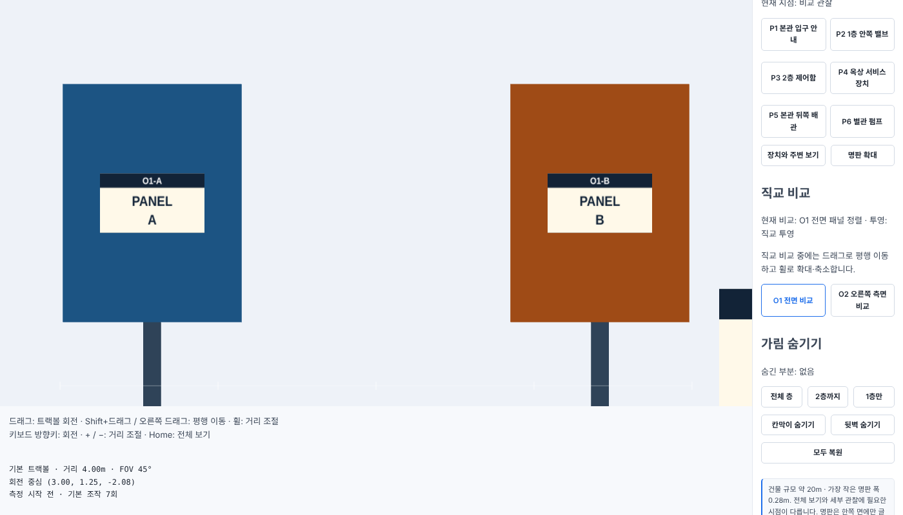
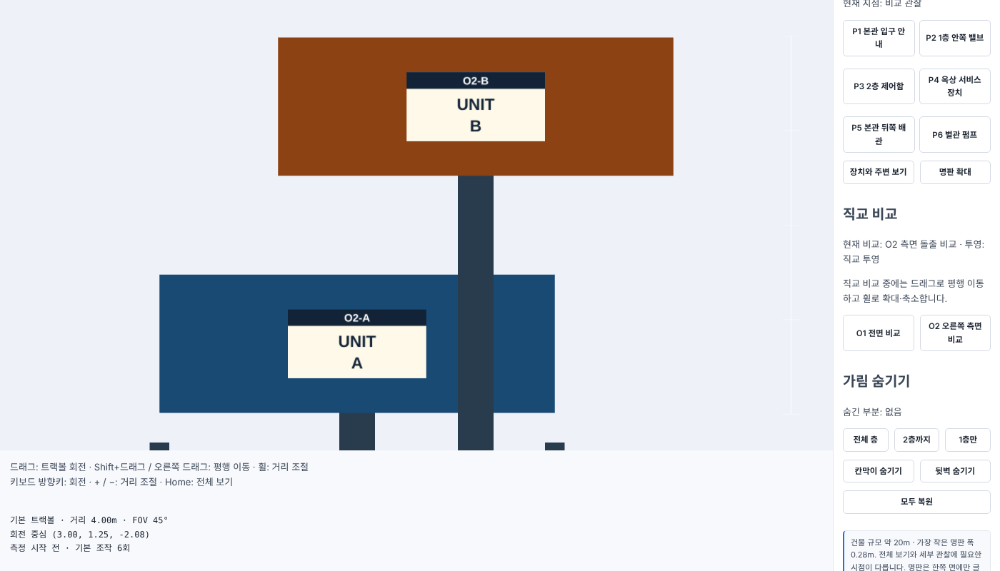
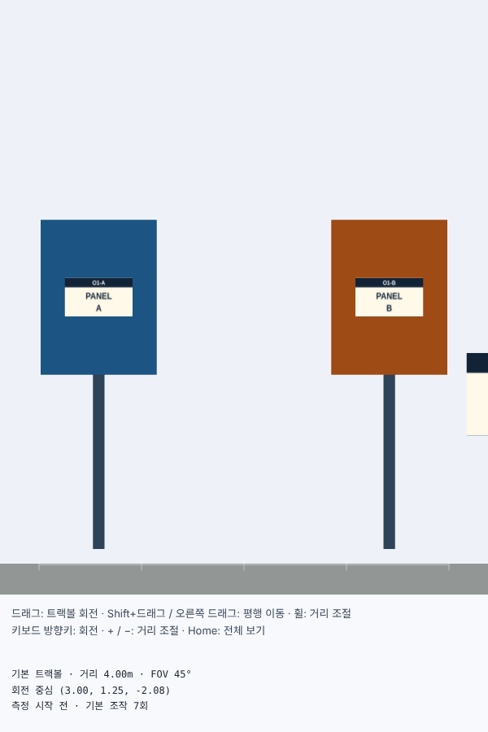
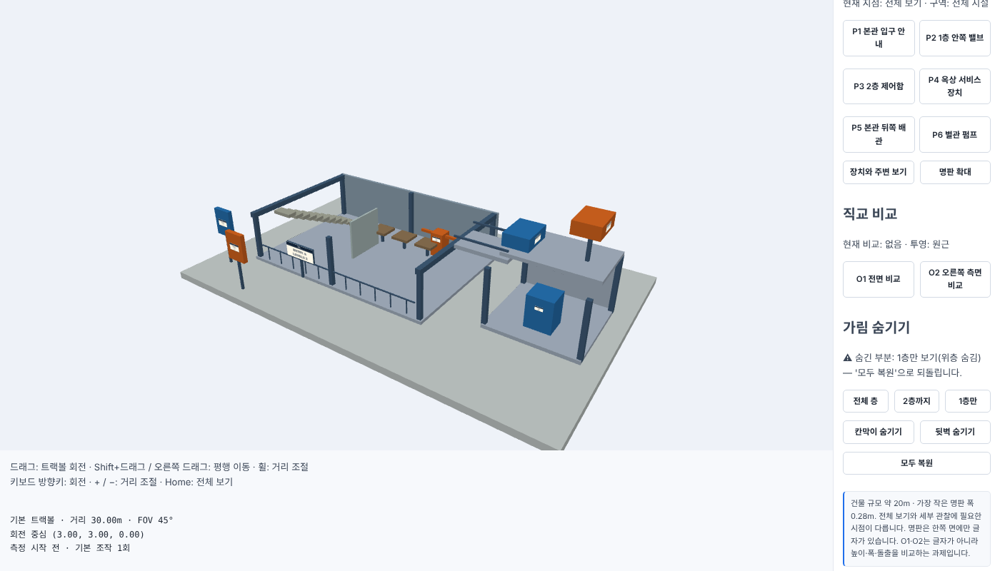
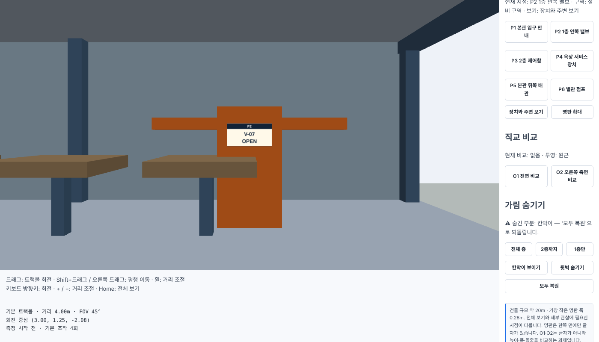
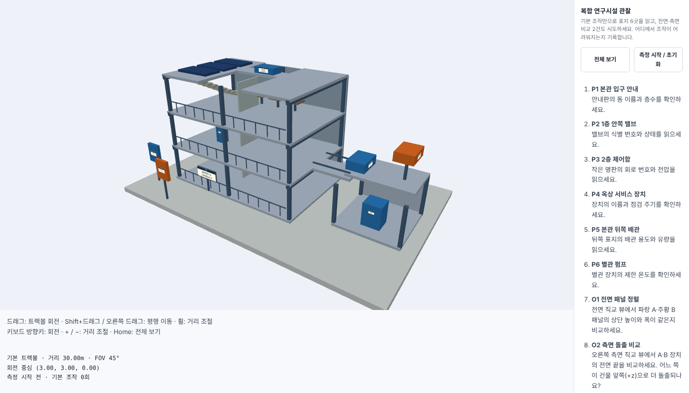

# 4주차 실습 보고서 — 카메라와 투영

## 1. 실습 목적

기본 3D 트랙볼 조작으로 복합 연구시설의 표지와 장치를 관찰하고,
3D 조작에 익숙하지 않은 사용자도 필요한 정보를 쉽게 확인할 수 있도록
카메라와 관찰 인터페이스를 개선했다.

이번 과제에서는 지점 선택, 정면 관찰, 명판 확대, 주변 보기,
전면·측면 직교 비교, 위층·칸막이·뒷벽 숨기기 기능을 구현했다.

## 2. 실행 주소와 조작법

- 기본 버전: [baseline 실행 주소](https://yeonynywhat.github.io/computerGraphics/week4/baseline/)
- 개선 버전: [improved 실행 주소](https://yeonynywhat.github.io/computerGraphics/week4/improved/)

기본 조작은 마우스 드래그로 회전, Shift 드래그 또는 오른쪽 버튼 드래그로 평행 이동,
휠로 거리 조절, Home 키로 전체 보기이다.

개선 버전에서는 오른쪽 지점 버튼으로 관찰 지점을 선택할 수 있다.
선택 후 `명판 확대`와 `장치와 주변 보기`를 전환할 수 있으며,
O1·O2 직교 비교 버튼으로 구조를 비교할 수 있다.
`가림 숨기기`에서 `2층까지`·`1층만`으로 위층을 잘라 내거나 칸막이·뒷벽을 숨길 수 있고,
현재 숨긴 부분이 표시되며 `모두 복원`으로 되돌린다. `전체 보기`(Home)로 언제든 전체 시점에 복귀한다.

## 3. 기본 버전 관찰

### 3.1. 관찰 결과

| 지점 | 확인한 정보 | 관찰 결과 |
|---|---|---|
| P1 | ENTRY A / LEVELS 3 | 본관 입구 안내판을 확인했다. |
| P2 | V-07 / OPEN | 칸막이가 시야를 가리고 위아래 공간이 좁았다. |
| P3 | B-12 / 24V | 건물 중심을 기준으로 움직여 2층 제어함 접근이 오래 걸렸다. |
| P4 | FILTER / 30 DAYS | 명판을 정면으로 맞추기 어려웠다. |
| P5 | RETURN / 8 L/min | 접근 과정에서 화면과 명판이 크게 기울었다. |
| P6 | LIMIT / 80 C | 명판을 읽기 위한 회전 방향을 맞추기 어려웠다. |
| O1 | 패널 A·B | 원근 화면에서는 거리 차이 때문에 실제 높이와 폭을 판단하기 어려웠다. |
| O2 | 장치 A·B | 기본 화면에서 B가 더 돌출되어 보였다. |

### 3.2. 기본 버전의 불편

P2에서는 칸막이가 명판을 가려 원하는 위치에서 정보를 읽기 어려웠다.

P3에서는 회전 중심이 건물 전체에 있어 특정 제어함으로 이동하는 데 시간이 오래 걸렸다.

P4~P6에서는 명판을 찾은 뒤에도 정면과 위쪽 방향을 맞추기 위한 조작이 필요했다.

O1에서는 원근 투영 때문에 화면에서 보이는 크기 차이가 실제 폭 차이인지 판단하기 어려웠다.

## 4. 사용자와 개선 목표

사용자는 시설을 처음 보는 3D 조작 초보 점검자로 정했다.

관찰 목표는 다음과 같다.

- 표지를 읽기 좋은 거리와 방향으로 빠르게 이동한다.
- 작은 명판과 주변 장치를 함께 확인한다.
- 여덟 관찰 과제를 빠뜨리지 않는다.
- O1과 O2를 같은 배율의 직교 화면에서 비교한다.

## 5. 개선안 비교

### 대안 A — 지점 선택과 큰 상세 화면

지점 버튼을 누르면 선택한 대상의 정면으로 이동하고,
명판 확대와 주변 보기 사이를 전환하는 방식이다.

장점은 작은 명판을 쉽게 읽고 필요한 지점으로 빠르게 이동할 수 있다는 점이다.
단점은 상세 화면만 보면 전체 건물에서의 위치를 놓칠 수 있다는 점이다.

### 대안 B — 전체 지도와 상세 화면

전체 건물 위치를 작은 화면으로 유지하고, 선택한 대상을 큰 화면에서 보는 방식이다.

장점은 세부 정보와 전체 위치를 동시에 확인할 수 있다는 점이다.
단점은 화면과 카메라 관리가 복잡해지고 상세 화면이 좁아질 수 있다는 점이다.

이번 과제에서는 반복적으로 발생한 정면 접근과 명판 가독성 문제를 먼저 해결하기 위해
대안 A를 선택했다. O1과 O2는 별도의 직교 비교 화면으로 추가했다.

## 6. 구현 내용

### 6.1. 지점 선택 카메라

P1~P6 버튼을 추가하고, 선택한 POI의 위치와 명판 방향을 이용해
카메라의 위치와 바라보는 점을 계산했다.

선택한 명판은 화면 정면에 오도록 하고, 명판 확대 모드에서는 가까이 배치했다.
주변 보기 모드에서는 거리를 늘려 장치 본체와 주변 구조가 함께 보이도록 했다.

선택한 대상의 위치를 회전 중심으로 사용했기 때문에,
선택 후 드래그해도 건물 전체가 아니라 해당 장치를 중심으로 회전한다.

카메라는 다음과 같이 정한다.

| 항목 | 결정 방법 |
| --- | --- |
| target | 선택한 명판의 중심 `poi.position` (= 회전 중심) |
| eye | target에서 명판의 앞 방향(명판 `yaw`로 계산)으로 distance만큼 떨어진 점 → 항상 명판 정면 |
| up | +y (명판이 기울어 보이지 않게) |
| distance | 화면에 넣을 범위의 반높이 h, 반폭 w에 대해 `max(h / tan(θ/2), w / (tan(θ/2)·aspect))` |

거리 공식은 원근 투영에서 깊이 d의 반높이가 `d·tan(θ/2)`라는 관계를 거꾸로 쓴 것이다.
명판 확대에서는 명판 크기에 여백(세로 1.0m, 가로 1.2m)을 더한 범위를, 주변 보기에서는 장치 주변 상자들(반경 2.5m 안)을 범위로 쓴다.
그래서 폭 2m 안내판(P1)은 멀리서, 폭 0.28m 명판은 가까이에서 보게 되어, 크기가 다른 표지도 화면에서 비슷한 크기로 읽힌다.
화면 비율(aspect)을 공식에 넣었기 때문에 창이 세로로 길어지면 가로 범위가 들어오도록 자동으로 더 멀어진다.

```js
distance = Math.max(distance,
  depthTowardCamera + Math.max(vertical / tanHalfVertical,
                               horizontal / (tanHalfVertical * aspect)));
```

### 6.2. 명판 확대와 주변 보기

명판 확대는 글자를 읽기 위한 가까운 시점이다.
장치와 주변 보기는 대상이 건물 어디에 있는지 확인하기 위한 시점이다.

두 모드를 버튼으로 전환할 수 있으며, P2에서도 명판과 주변 구조를 각각 확인할 수 있었다.

### 6.3. 직교 비교

O1은 건물 앞쪽에서 뒤쪽을 바라보는 전면 직교 뷰로 구현했다.
이 화면에서는 패널 A와 B의 상단 높이와 폭을 같은 배율로 비교할 수 있다.

O2는 건물 오른쪽에서 왼쪽을 바라보는 측면 직교 뷰로 구현했다.
이 화면에서는 장치 A와 B의 앞쪽 끝이 어느 쪽으로 더 돌출되는지 비교할 수 있다.

직교 투영은 거리에 따른 크기 변화를 제거하므로 실제 높이, 폭, 돌출 정도를 비교하기에 적합하다.

두 대상은 **한 화면 안에서 같은 투영**으로 그리므로 배율이 같다. 대상마다 따로 확대한 화면을 나란히 놓으면 배율이 달라 비교할 수 없기 때문이다.
직교 범위의 반높이는 두 대상을 감싸는 상자의 세로·가로 크기 중 큰 쪽에 여백 1.2배를 곱해 정하고, 가로 범위는 `반높이 × aspect`로 정해 화면 비율이 바뀌어도 찌그러지지 않게 했다.
비교 중에는 회전을 막고 평행 이동과 확대·축소만 허용해, 축 정렬이 깨지지 않게 했다.

| O1 전면 직교 (+z → −z, up +y) | O2 오른쪽 측면 직교 (+x → −x, up +y) |
| --- | --- |
|  |  |

세로로 긴 창에서도 O1 패널의 가로·세로 비율이 유지되었다.



### 6.4. 가림 숨기기

P2에서 칸막이가 명판을 가렸고, 2층 제어함(P3)을 보려면 1층 위로 돌아가야 했다.
그래서 건물을 위에서부터 잘라 내는 층 보기(`전체 층`·`2층까지`·`1층만`)와
칸막이·뒷벽 숨기기를 추가했다.

- 모델 데이터는 바꾸지 않고, 렌더러의 `hidden` 집합에 상자 id를 넣어 그리지 않기만 한다.
- 층 보기는 본관 범위(|x| ≤ 6.5m) 안에서 바닥면이 기준 높이(2층 6m, 1층 3m) 이상인 상자를 숨긴다. 별관·다리·O1·O2 비교 대상은 숨기지 않는다.
- 잘린 층에 붙은 명판도 함께 숨겨 공중에 떠 보이지 않게 했다.
- 사이드바에 `⚠ 숨긴 부분: …`을 항상 표시하고, `모두 복원` 버튼으로 한 번에 되돌린다.

| 1층만 보기 | P2에서 칸막이 숨김 |
| --- | --- |
|  |  |

```js
const aboveCut = inMainBuilding(part.position) && partBottom(part) >= floorCut.cutY - 0.1;
if (aboveCut || wallHidden) viewer.hidden.add(part.id);
```

## 7. 개선 결과

O1 전면 직교 뷰에서 패널 A와 B의 상단 높이와 폭은 같았다.
기본 원근 화면에서는 거리 차이 때문에 판단하기 어려웠지만,
직교 뷰에서는 같은 배율로 비교할 수 있었다.

O2 오른쪽 측면 직교 뷰(+z가 화면 왼쪽)에서는 **A의 전면 끝이 B보다 왼쪽, 즉 건물 앞쪽(+z)으로 더 나와 있었다.**
모델 좌표로도 A의 전면 끝은 z = 0 + 2/2 = 1.0, B는 z = −0.6 + 2/2 = 0.4이다.
기본 원근 화면에서는 B가 더 돌출되어 보였는데, B가 더 높고(y 5.35) 오른쪽 카메라에 더 가까워(x 12.3) 크게 보였기 때문이다.
처음 기록에서는 직교 뷰 결과도 B로 적었으나, 화면 축 방향(+z = 왼쪽)과 모델 좌표를 다시 확인해 A로 정정했다.
원근 화면의 착시를 직교 뷰가 바로잡은 사례이다.

지점 버튼을 사용하면 기본 트랙볼로 직접 찾을 때보다 명판을 읽기 좋은 방향으로
빠르게 이동할 수 있었다. 명판 확대와 주변 보기 전환을 사용하면
글자와 주변 장치를 각각 확인할 수 있었다.

## 8. 개선 전후 캡처

### 기본 버전


### 개선 버전




## 9. Copilot 활용

Copilot에게 먼저 기존 파일 구조와 카메라, 투영, POI 데이터의 위치를 설명하도록 요청했다.

그다음 지점 선택 카메라, 명판 확대와 주변 보기, O1·O2 직교 비교 기능을
기존 `InspectionViewer`와 `drawView()` 구조에 맞게 수정하도록 요청했다.

처음 구현에서는 명판이 너무 가까워 주변 환경이 보이지 않았다.
실행 결과를 확인한 뒤 카메라 거리를 늘리고 `명판 확대`와
`장치와 주변 보기`를 나누도록 다시 요청했다.

Copilot이 제안한 코드는 실행 화면과 교수님의 조건을 비교하며 확인했다.
모델의 위치와 명판 내용은 유지하고, 카메라와 UI만 개선했다.

## 10. 한계와 추가 개선

이번 관찰에서 기본 버전의 정확한 시간과 조작 횟수는 별도로 측정하지 못했다.
따라서 개선 버전이 몇 초 또는 몇 회 더 효율적인지는 단정하지 않는다.

처음 개선 버전에는 숨김 기능이 없어 P2 칸막이 가림이 남아 있었다.
이후 층 보기와 칸막이·뒷벽 숨기기를 추가하고, 숨긴 상태 표시와 `모두 복원`을 넣었다.
또 관찰 지점 버튼 6개가 한 줄에 들어가 글자가 세로로 쪼개져 보였기 때문에 2열 격자로 바꿨다.

남은 불편:
- 직교 비교의 눈금은 화면 위치 기준이라 m 단위 길이를 직접 읽을 수는 없다.
- 숨김은 수동이라, 사용자가 어떤 층을 숨겨야 하는지 스스로 판단해야 한다. 지점 선택 시 자동으로 위층을 숨기는 방식은 검토했지만, 전체 구조를 잃을 수 있어 수동으로 두었다.

### 측정 비교

| 항목 | 기본 버전 | 개선 버전 |
| --- | --- | --- |
| 관찰 완료 수 (/8) | (측정 후 기입) | (측정 후 기입) |
| 전체 관찰 시간 | (측정 후 기입) | (측정 후 기입) |
| 기본 조작 횟수 (화면 카운터) | (측정 후 기입) | (측정 후 기입) |
| 새 UI 클릭 수 (직접 기록) | — | (측정 후 기입) |

측정 한계: 같은 사람이 두 번째로 수행하면 위치를 이미 알아 빨라지는 학습 효과가 있다. 휠 이벤트 수는 기기마다 달라 횟수만으로 결론 내리지 않는다.
