# 5주차 실습 보고서 — 빛과 색, Phong 조명 모델

## 실행 주소

- 실습 1 — 납작한 원을 구로 만들기: [task1.html](https://yeonynywhat.github.io/computerGraphics/week5/task1.html)
- 실습 2 — 해 질 무렵의 행성: [task2.html](https://yeonynywhat.github.io/computerGraphics/week5/task2.html)

### 조작법

| 실습 | 키 | 동작 |
| --- | --- | --- |
| 공통 | 드래그 / 휠 | 시점 회전 / 확대·축소 |
| 실습 1 | `1`~`4` | 단계 전환 (1 확산광 · 2 +환경광 · 3 +정반사 · 4 +거리 감쇠) |
| 실습 1 | `X` | `max(dot(N, L), 0)`의 `max` 제거 실험 |
| 실습 1 | `[` `]` | 환경광 세기 0.00~0.40 |
| 실습 1 | `L` | 광원 종류 point → directional → spot |
| 실습 1 | `S` / `N` | 행성 비균등 스케일 켜기·끄기 / 법선 변환 `uNormalMat` ↔ `mat3(uModel)` |
| 실습 1 | `R` | 처음 상태(단계 4, point, 비균등 스케일, `uNormalMat`) |
| 실습 2 | `1` / `2` | 주황 점광원(해) / 푸른 방향광(하늘빛) 켜기·끄기 |

실습 1은 단계마다 파일을 따로 두지 않고, 한 파일에서 키로 단계를 바꿔 **같은 각도에서** 비교할 수 있게 했다. 화면 왼쪽 위에 현재 단계와 설정이 표시된다.

---

## 1. 핵심 개념

물체의 색은 "어떤 빛이 왔고 그중 무엇을 되돌려 보냈는가"이므로, 광원색과 물체색을 **곱해서** 계산한다. 같은 빛에서도 물체가 달라 보이는 이유 중 이번 주의 핵심은 **어느 방향으로 반사하는가**이며, Phong 모델은 이를 세 항으로 근사한다.

```
I = ka·base  +  base·light·max(N·L, 0)  +  light·ks·max(R·V, 0)^α
     환경광          확산광(diffuse)              정반사(specular)
```

| 항 | 흉내 내는 현상 | 필요한 벡터 | 보는 방향에 따라 |
| --- | --- | --- | --- |
| ambient | 주변에서 돌아온 간접광 | 없음 | 변하지 않음 |
| diffuse | 표면 안에서 산란 후 사방으로 | N, L | 변하지 않음 |
| specular | 표면에서 바로 튕긴 빛 | N, L, V(R) | 변함 |

N, L, V, R은 모두 **월드 좌표의 단위 벡터**다. 광원 종류의 차이는 **L을 어떻게 구하는가**와 **거리 감쇠가 있는가** 두 가지뿐이다.

---

## 2. 실습 1 — 납작한 원을 구로 만들기

### 0단계 — 왜 원으로 보였나

처음에는 모든 픽셀이 같은 색이라 구가 원으로 보였다. 구로 보이려면 **픽셀마다 밝기가 달라져야** 하고, 그러려면 픽셀마다 다른 값인 **표면 방향(법선 N)**이 색 계산에 들어가야 한다.

### 단계 1~4 — 세 항을 하나씩 더하기 (같은 각도)

| 단계 1 — 확산광 | 단계 2 — +환경광 |
| --- | --- |
| 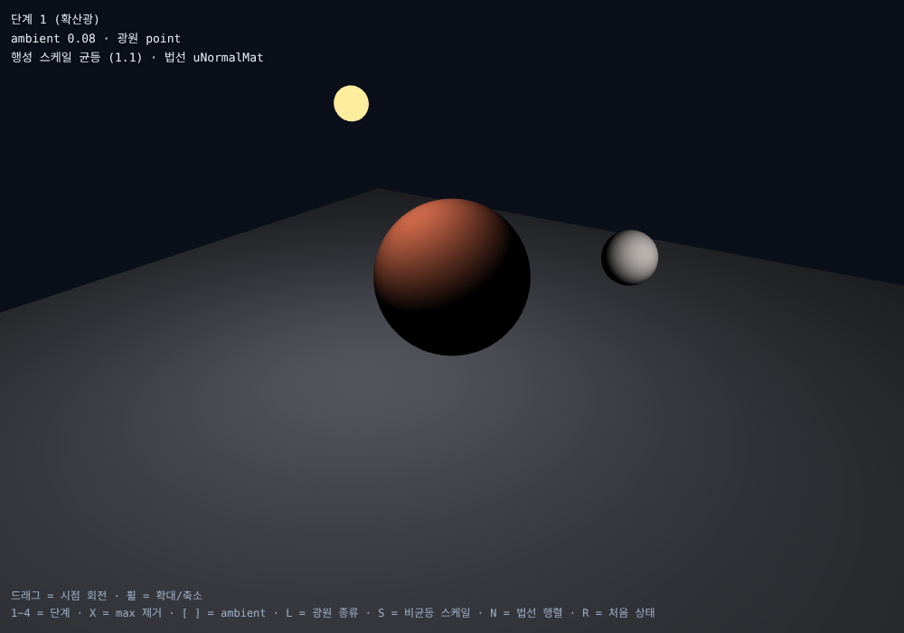 | 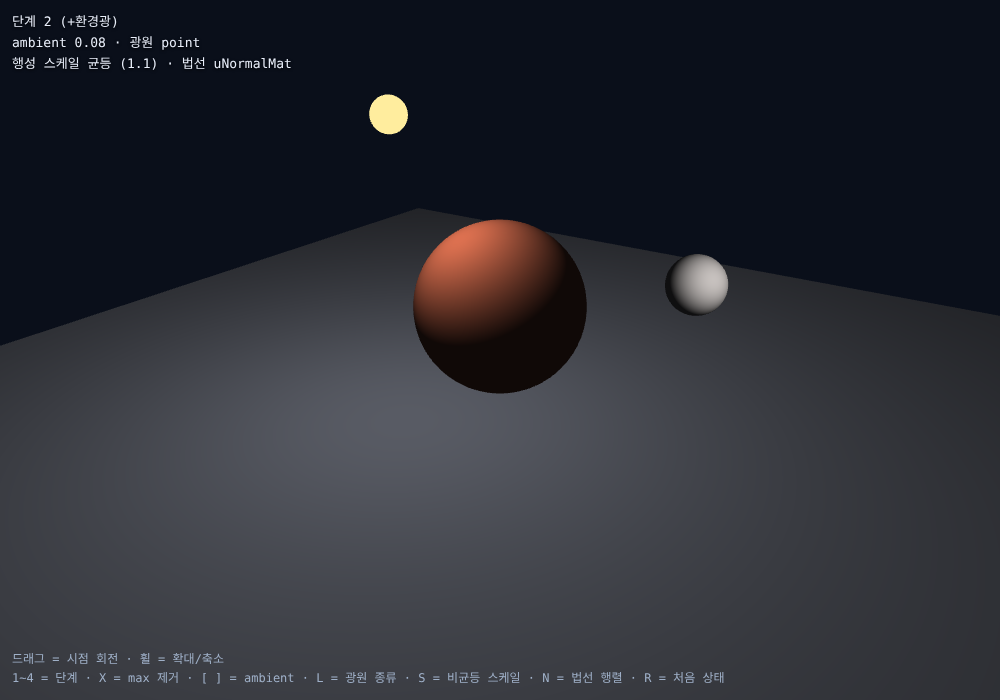 |
| **단계 3 — +정반사** | **단계 4 — +거리 감쇠** |
| 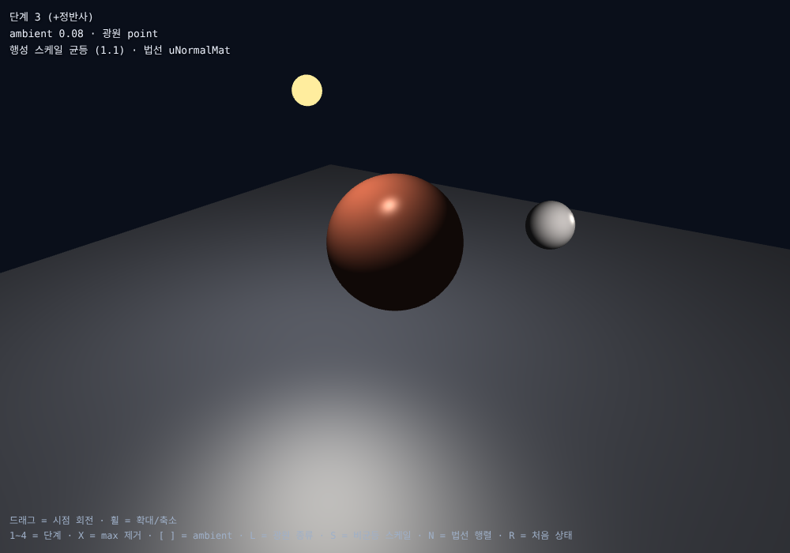 |  |

- **단계 1:** `diffuse = max(dot(N, L), 0.0) * uBaseColor * uLightColor`. 빛을 향한 쪽은 밝고 등진 쪽은 0이 되어 **밤낮 경계**가 생기고 원이 구로 보인다. 밤쪽은 완전히 검다.
- **단계 2:** `ambient = 0.08 * uBaseColor`. 밤쪽이 완전한 검정에서 물체색이 살짝 남는 정도로 바뀐다.
- **단계 3:** `R = reflect(-L, N)`, `specular = pow(max(dot(R, V), 0.0), uShininess) * uLightColor * 0.5`. 행성(shininess 32)과 달(16)에 흰 하이라이트가 생긴다. 달의 하이라이트가 더 넓고 흐리다. 하이라이트가 물체색이 아니라 **광원색(흰색)**인 것은 specular에 `uBaseColor`를 곱하지 않았기 때문이다.
- **단계 4:** `att = 1.0 / (1.0 + 0.02 * d * d)`를 diffuse와 specular에 곱했다. 광원 바로 아래 바닥은 밝고 멀어질수록 어두워져 **바닥에 밝기 분포**가 생겼다. ambient에는 곱하지 않았다. 환경광은 특정 광원에서 오는 빛이 아니기 때문이다.

### 단계 1 — `max`를 지우면?

**예측:** `dot(N, L)`은 빛을 등진 면에서 음수가 된다. `max`를 지우면 그 면이 음수 밝기가 되어 더 어두워지거나 이상한 색이 나올 것이다.

**실제 결과:** 단계 1(환경광 없음)에서는 `max`를 지워도 **화면이 똑같았다.** 화면에 출력되는 색은 0~1 범위로 잘리기 때문에, 음수는 그냥 0(검정)으로 보인다.

차이는 **환경광을 더한 뒤에** 드러났다. 환경광 0.3을 넣고 비교하면 다음과 같다.

| `max` 있음 (ambient 0.3) | `max` 없음 (ambient 0.3) |
| --- | --- |
| 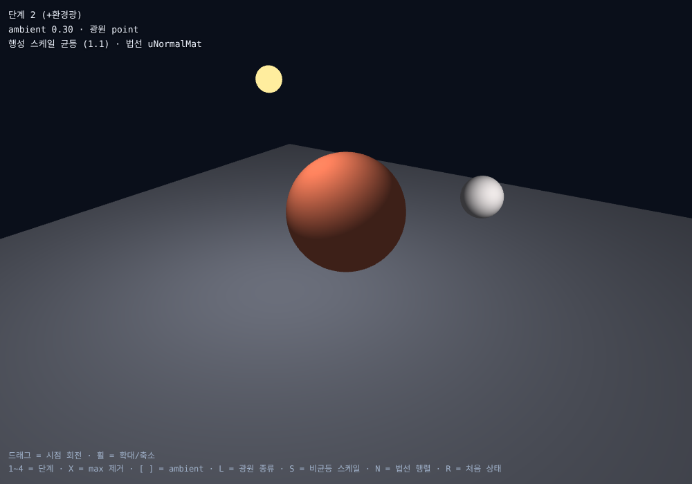 | 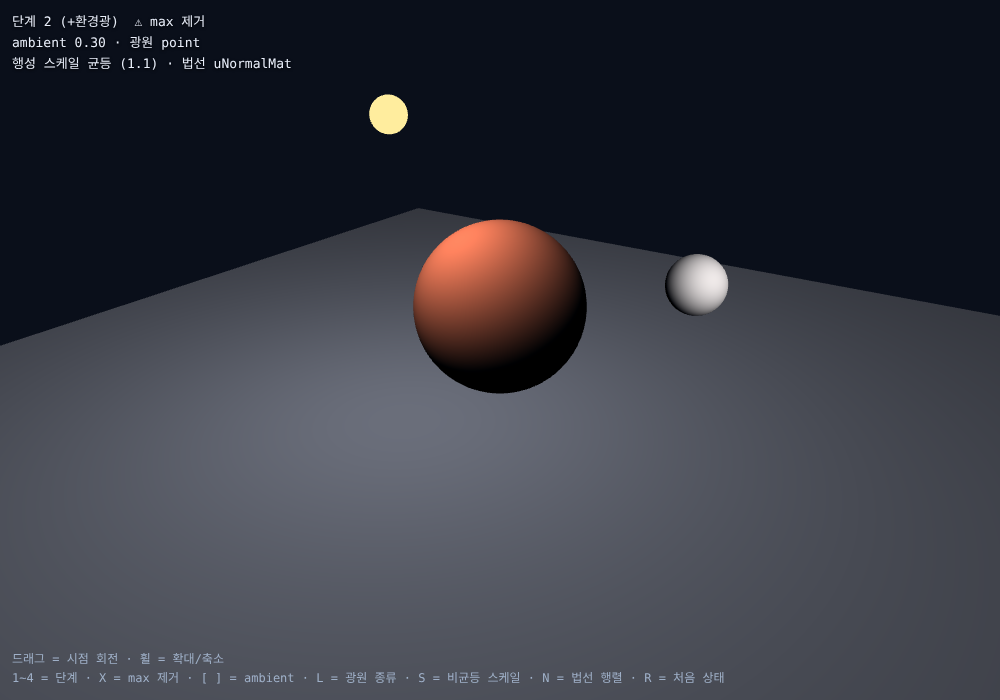 |

`max`가 없으면 밤쪽의 음수 diffuse가 **환경광까지 깎아 먹어** 밤쪽이 다시 새까매진다. 즉 `max`는 "등진 면은 빛을 0만큼 받는다"를 보장해, 다른 빛(환경광, 다른 광원)을 빼앗지 않게 하는 역할이다. 예측의 "더 어두워진다"는 맞았지만, 단독으로는 화면에서 보이지 않는다는 점은 예상하지 못했다.

### 단계 1·3 — 시점을 돌리면?

| 기본 시점 | 시점을 돌린 뒤 |
| --- | --- |
|  | 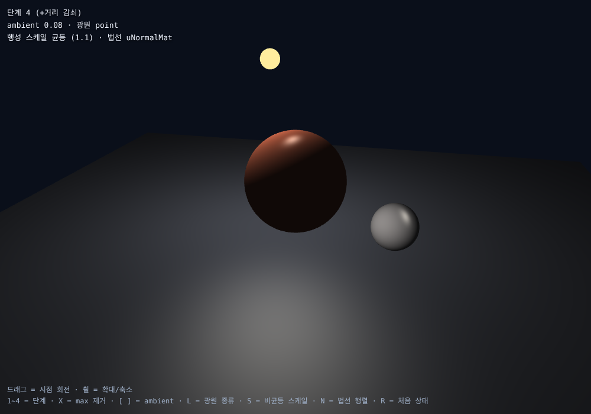 |

밤낮 경계의 위치(구의 어느 부분이 밝은지)는 그대로이고, **하이라이트만 위치가 바뀌었다.** diffuse는 N과 L만 쓰고 V를 쓰지 않기 때문이며, specular는 `R·V`를 쓰므로 카메라 위치 `uViewPos`를 매 프레임 넘겨야 한다.

### 단계 2 — 환경광 세기

| ambient 0.00 | ambient 0.40 |
| --- | --- |
| 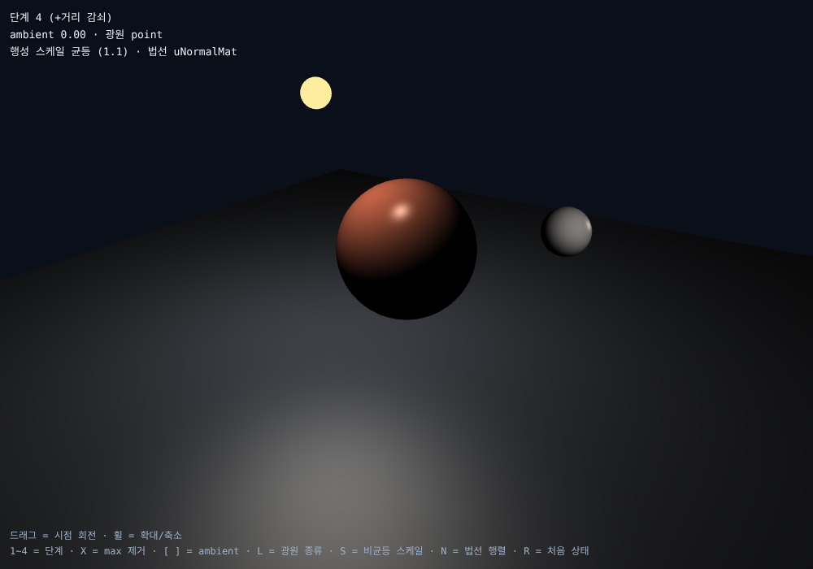 | 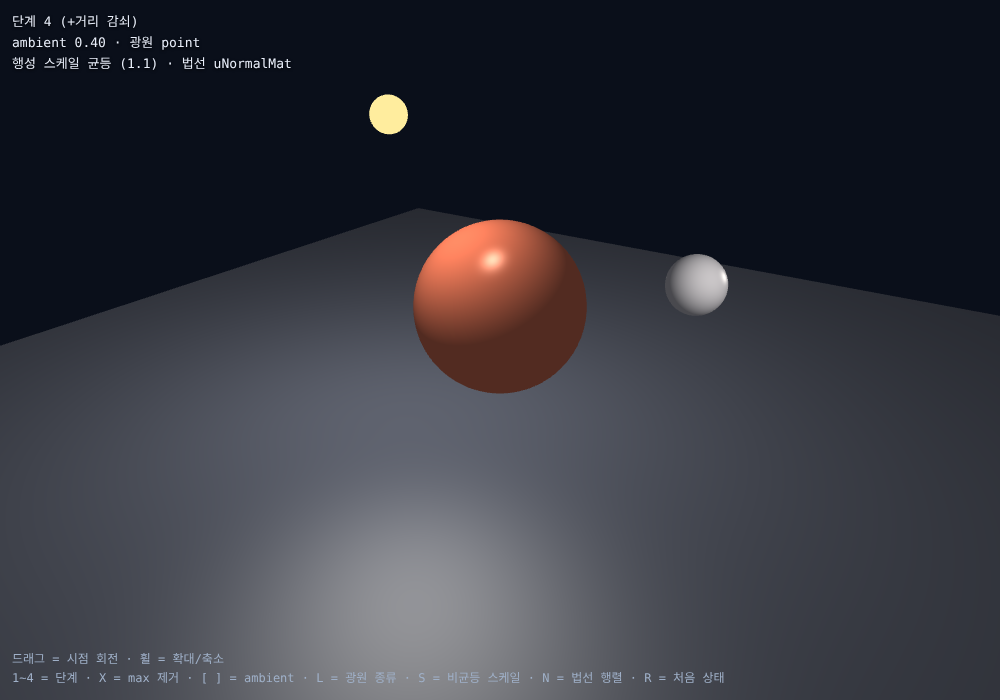 |

0이면 밤쪽이 완전히 검다. 0.4이면 밤쪽도 밝아져 **밤낮 대비가 줄고 입체감이 약해진다.** 입체감은 밝기 차이에서 오는데, 환경광은 모든 면에 똑같이 더해져 그 차이를 상대적으로 줄이기 때문이다. 기본값 0.08을 유지했다.

### 단계 3 — 빛을 등진 면의 하이라이트 막기

출발 코드의 식은 `dot(N, L) ≤ 0`인 면에서도 `R·V`가 양수일 수 있어, 빛을 등진 면에 하이라이트가 생길 수 있다. 그래서 정반사는 빛을 받는 면에서만 계산하도록 했다.

```glsl
vec3 specular = vec3(0.0);
if (uStage >= 3 && NdotL > 0.0) {          // 빛을 등진 면에는 하이라이트를 만들지 않는다
  vec3 R = reflect(-L, N);                 // reflect 는 입사 벡터를 받으므로 -L
  specular = pow(max(dot(R, V), 0.0), uShininess) * uLightColor * 0.5;
}
```

### 단계 5 — 법선 행렬 (행성 스케일 x·z 0.7, y 2.2)

| `mat3(uModel) * aNormal` | `uNormalMat * aNormal` |
| --- | --- |
| 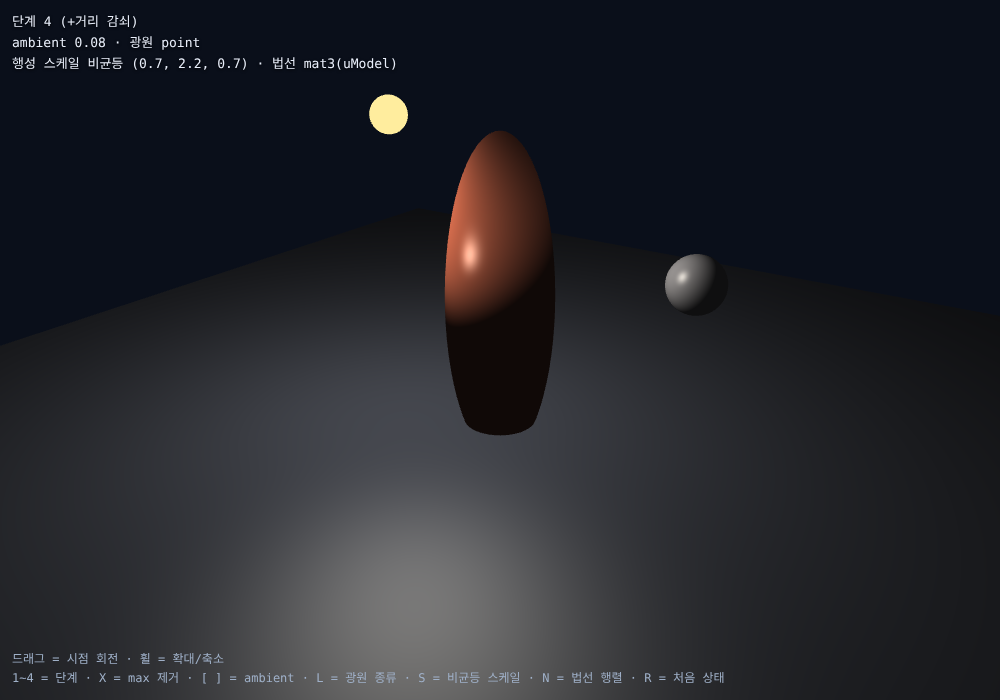 | 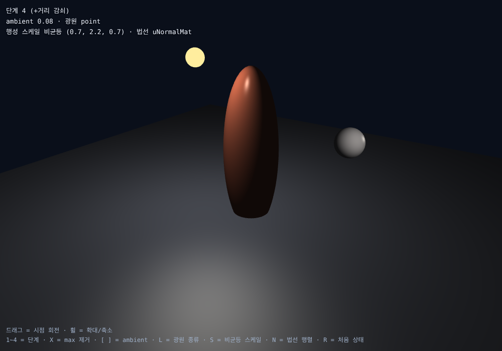 |

모델 행렬을 법선에 그대로 곱하면, y로 늘린 만큼 법선도 y 쪽으로 늘어나 **표면에 수직이 아니게** 된다. 그래서 왼쪽 캡처는 하이라이트와 밝은 영역이 길쭉한 행성의 모양과 어긋나고, 옆면이 실제보다 위를 향한 것처럼 밝게 칠해졌다. 법선 행렬(모델 행렬 3×3 부분의 **역전치**)을 쓰면 늘어난 방향으로는 오히려 줄어들어 법선이 표면에 수직으로 유지되고, 오른쪽처럼 길쭉한 형태를 따라 자연스럽게 밝아진다. 균등 스케일에서는 두 방식의 방향이 같아(길이만 다르고 `normalize`로 맞춰짐) 차이가 없었다. 법선은 방향이라 이동의 영향을 받지 않도록 3×3 부분만 쓴다.

### 단계 6 — 광원 종류 바꾸기

| point | directional `(0.4, 0.8, 0.5)` | spot (아래 방향, 안 25° / 밖 55°) |
| --- | --- | --- |
| 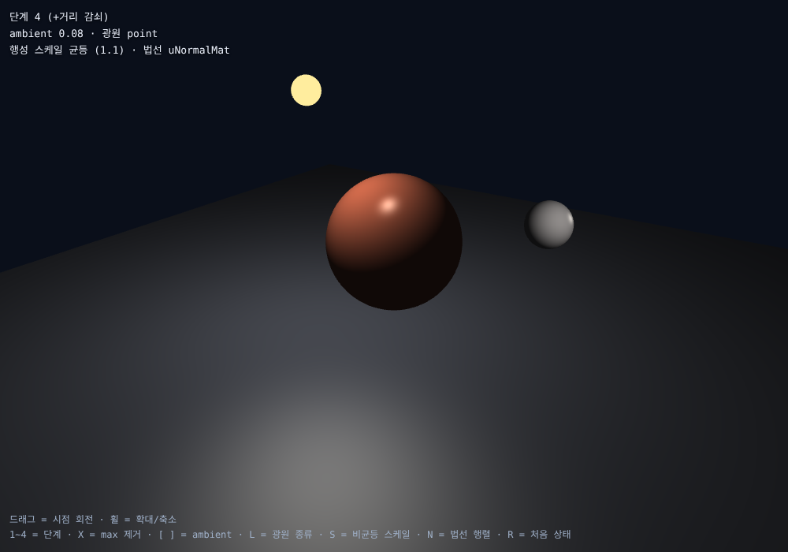 | 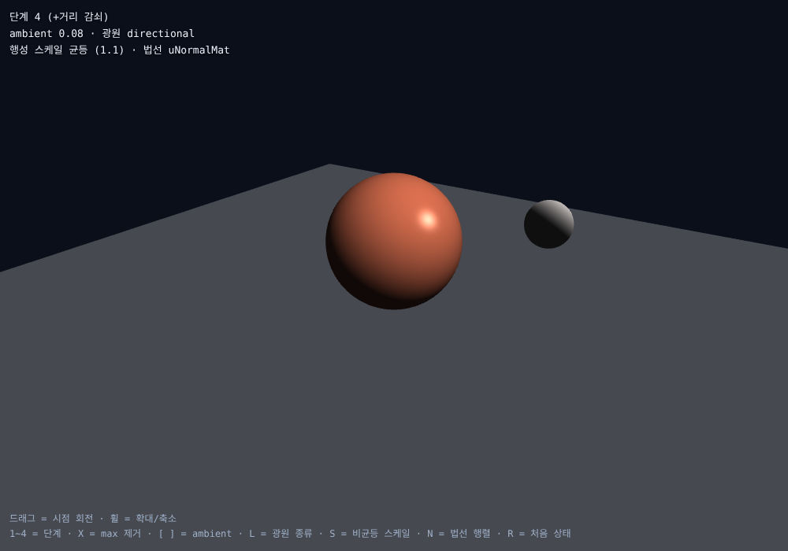 | 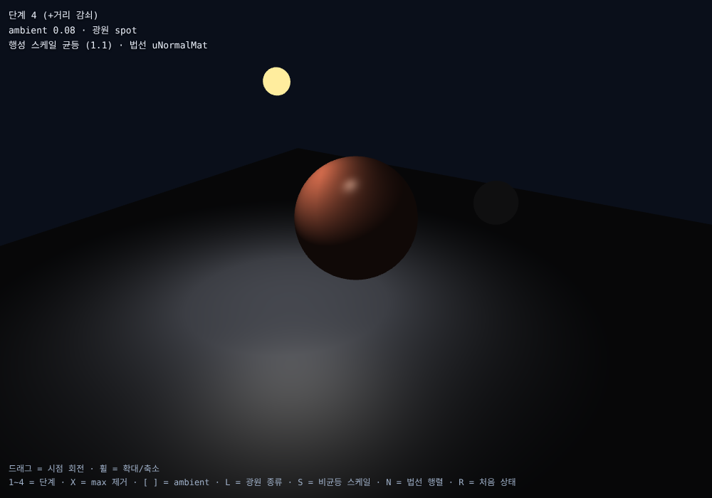 |

point에서는 광원 바로 아래 바닥이 밝고 멀어질수록 어두워졌다. 픽셀마다 L이 다르고 거리 감쇠가 있기 때문이다. directional로 바꾸자 **바닥 전체가 고르게 같은 밝기**가 되었다. 바닥은 평면이라 법선이 모두 같은데, directional은 모든 픽셀에서 L이 같고 감쇠도 없으므로 `N·L`이 바닥 어디서나 같기 때문이다. spot은 point와 같이 계산한 뒤, 광원에서 픽셀로 가는 방향과 spot 방향의 코사인 `c = -L·spotDir`을 안쪽·바깥쪽 각의 코사인과 비교해 원뿔 밖을 잘라 낸다. 그래서 **바닥에 밝은 원**이 생기고 원뿔 밖의 달은 거의 보이지 않는다. 각도 대신 cos 값을 비교해 `acos`를 쓰지 않았고, 안쪽에서 바깥쪽 각 사이를 선형으로 줄여 원의 테두리가 부드럽다.

```glsl
if (uLightType == 1) {
  L = normalize(uDirLight);                       // directional: 모든 픽셀에서 같은 방향, 감쇠 없음
} else {
  L = normalize(uLightPos - vWorldPos);           // point/spot: 픽셀마다 방향이 다르다
  att = 1.0 / (1.0 + 0.02 * d * d);
  if (uLightType == 2) {
    float c = dot(-L, normalize(uSpotDir));
    spot = clamp((c - uCosOuter) / (uCosInner - uCosOuter), 0.0, 1.0);
  }
}
```

광원 위치의 노란 구는 `uEmissive` 분기로 조명 계산 없이 색을 그대로 출력해 항상 밝다. directional은 위치가 없으므로 이 구를 그리지 않는다.

---

## 3. 실습 2 — 해 질 무렵의 행성

### 의도

해가 지평선 바로 위에 걸린 순간의 외계 행성 표면을 만들고 싶었다. 낮게 깔린 주황 햇빛이 물체의 한쪽만 붉게 물들이고, 나머지는 해가 진 하늘의 푸른빛으로만 희미하게 보이는 **따뜻함과 차가움의 대비**가 목표다.

### 방법

| 광원 | 종류 | 위치·방향 | 색 | 역할 |
| --- | --- | --- | --- | --- |
| `1` 해 | point | `(-4.5, 1.2, 3.0)` — 화면 왼쪽 지평선 근처, 낮게 | 주황 `(2.2, 0.85, 0.3)` | 물체 한쪽 면과 해 주변 바닥을 붉게 |
| `2` 하늘빛 | directional | `(0.2, 1.0, 0.3)` — 거의 바로 위 | 푸른색 `(0.22, 0.32, 0.6)` | 윗면과 바닥 전체를 차갑게 |

- **해를 point로 둔 이유:** 감쇠 때문에 해 가까운 바닥은 밝고 멀어질수록 어두워져, 지평선 쪽에서 빛이 번져 오는 느낌이 난다. 해가 멀어 감쇠가 크므로 색 값을 1보다 크게 주었다.
- **하늘빛을 directional로 둔 이유:** 하늘은 특정 점이 아니라 위쪽 전체에서 오는 빛이라 방향만 있고 감쇠가 없는 것이 맞다.
- **환경광은 0.03**으로 거의 없앴다. 두 광원을 다 끄면 장면이 거의 검게 되어, 장면의 빛이 모두 두 광원에서 온다는 것을 보여 준다.
- 배경색은 해가 진 직후의 보랏빛 `(0.09, 0.08, 0.16)`으로 했고, 해 위치에 큰 자체발광 구를 그려 빛의 출처가 보이게 했다.
- 두 광원은 각각 diffuse와 specular를 계산해 더하고, ambient는 한 번만 더한다. 각 광원에서 `dot(N, L) ≤ 0`이면 그 광원의 정반사도 계산하지 않는다.

**재질 구분**

| 물체 | 물체색 | shininess | ks | 표현 |
| --- | --- | --- | --- | --- |
| 큰 행성(암석) | 적갈색 `(0.55, 0.22, 0.1)` | 8 | 0.12 | 거칠고 무광인 바위 — 하이라이트가 넓고 약함 |
| 작은 구 | 청회색 `(0.55, 0.65, 0.75)` | 96 | 0.6 | 매끈한 금속 — 작고 날카로운 하이라이트 |
| 바닥 | 회청색 `(0.32, 0.34, 0.4)` | 8 | 0.12 | 평평한 지면 |

같은 두 광원 아래에서 두 구의 재질 차이가 드러난다. 적갈색 암석은 푸른 하늘빛을 받아도 거의 어둡다. **물체색 × 광원색**이라 빨강이 강한 물체는 파란 빛을 적게 반사하기 때문이다. 반면 청회색 구는 하늘빛 아래에서 푸르게 보인다.

### 광원을 하나씩 끈 캡처

| 둘 다 켬 (최종) | 해만 (`2` 끔) |
| --- | --- |
| 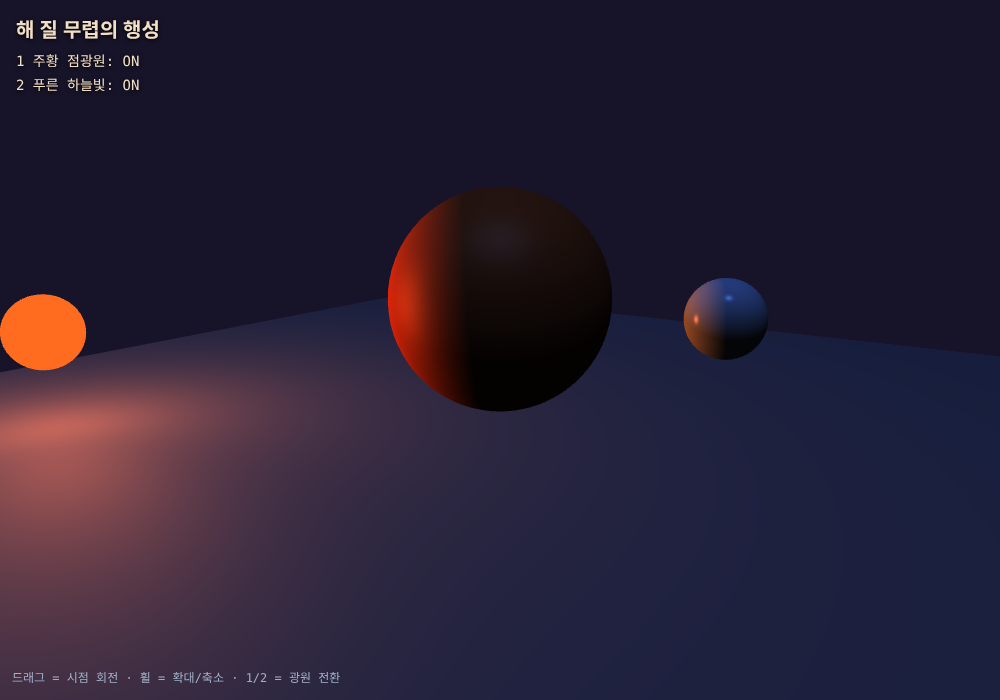 | 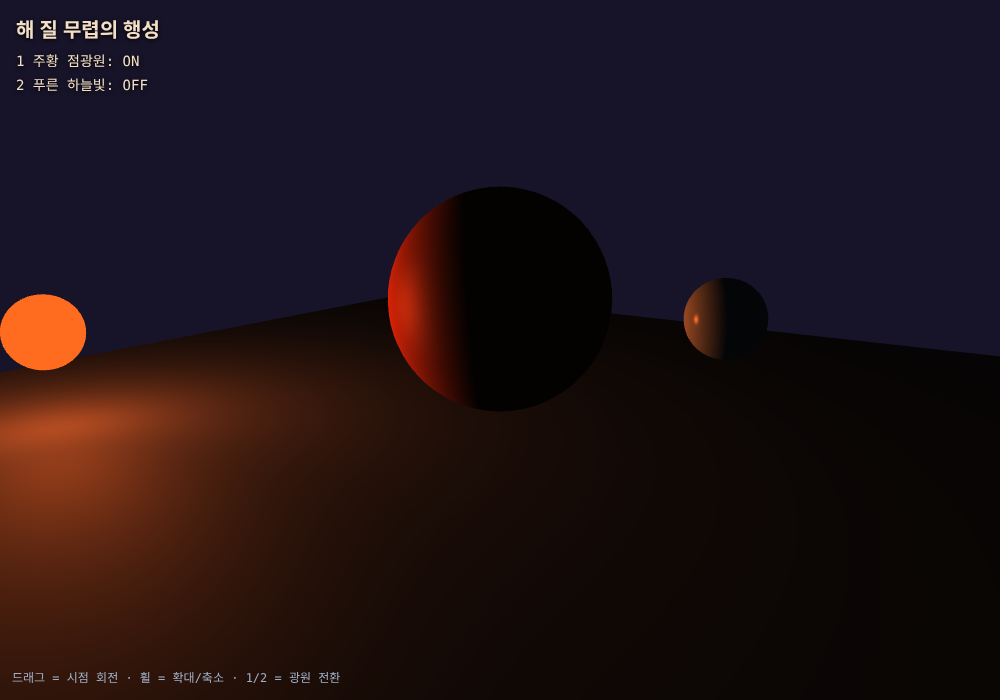 |
| **하늘빛만 (`1` 끔)** | **둘 다 끔** |
| 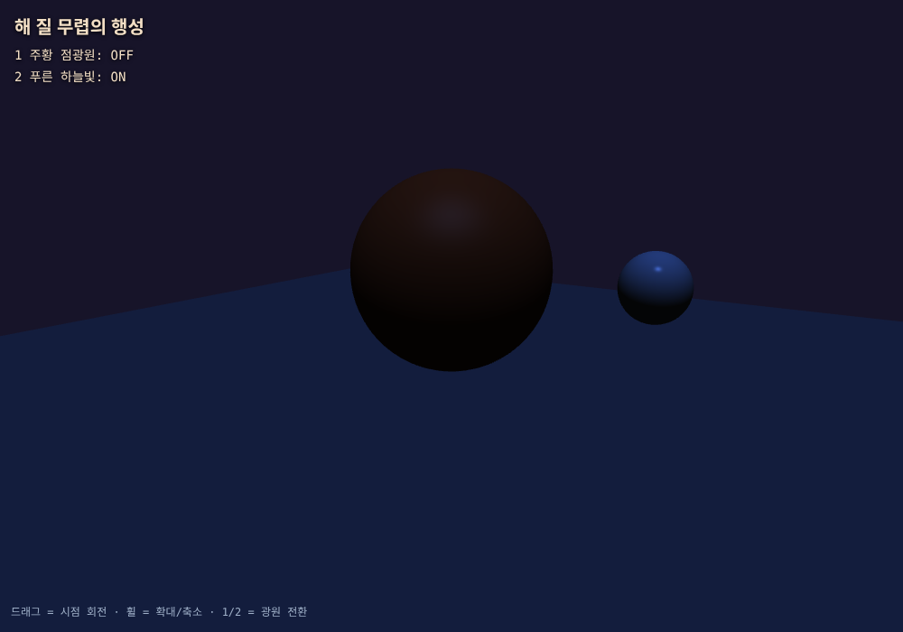 | 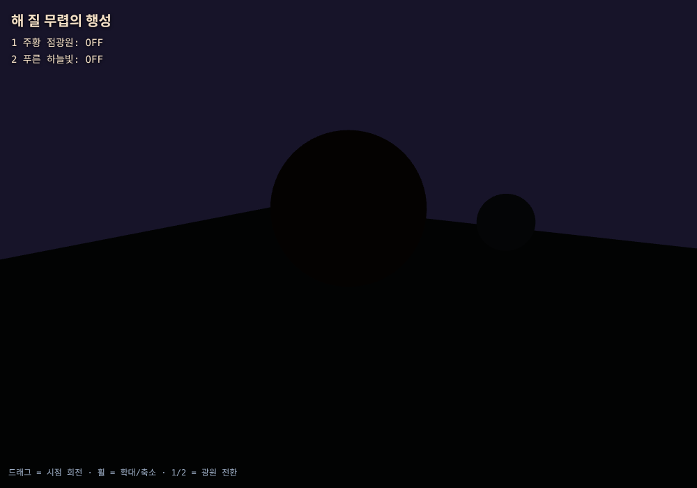 |

- **해만:** 물체의 왼쪽 면과 해 주변 바닥만 붉고, 나머지는 검다. 낮은 해의 방향성과 거리 감쇠가 보인다.
- **하늘빛만:** 바닥 전체가 고르게 푸르고, 물체는 윗면만 희미하게 밝다. 방향광이라 위치에 따른 밝기 차이가 없다.
- **둘 다 끔:** 환경광 0.03만 남아 거의 보이지 않는다.

### 수정 과정

처음 버전은 아래처럼 장면이 너무 어둡고 작아서 "해 질 무렵"으로 읽히지 않았다.

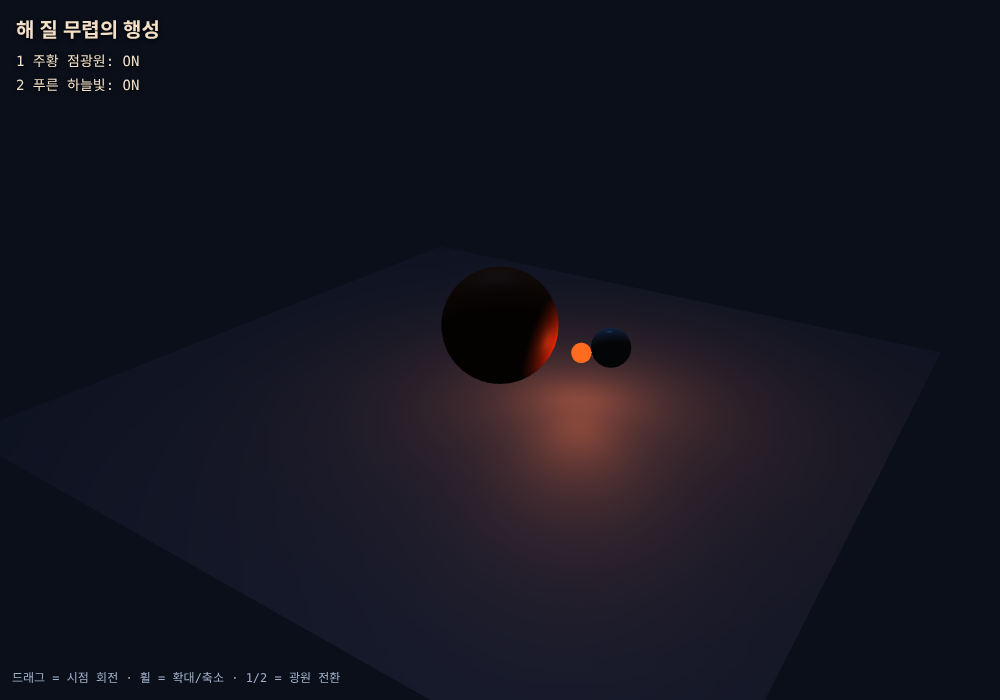

| 문제 | 원인 | 수정 |
| --- | --- | --- |
| 물체가 작고 무엇인지 안 보임 | 카메라 거리 19 | 거리 10, 눈높이를 낮춰 지평선이 보이게 |
| 해가 두 구 사이 낮은 곳에 있어 주로 바닥만 비춤 | 해 위치 `(1.8, 1.2, −0.5)` | 화면 왼쪽 지평선 근처 `(−4.5, 1.2, 3.0)`으로 옮겨 물체 한쪽을 비추게 |
| 해를 물체 뒤로 옮겼더니 가장자리만 가늘게 밝음 | 해가 카메라 반대편이라 밝은 면이 안 보임 | 해를 카메라 옆쪽으로 당겨 밝은 면과 어두운 면이 반씩 보이게 |
| 하늘빛을 켜고 꺼도 차이가 거의 없음 | 색 `(0.12, 0.2, 0.35)`가 너무 약함 | `(0.22, 0.32, 0.6)`으로 올리고 방향을 거의 위로 |

---

## 4. AI 활용

- 실습 1의 조명 코드는 강의의 단계별 식을 따라 넣었고, 과제 점검 단계에서 Claude에게 과제 조건과 비교해 부족한 점을 찾아 달라고 요청했다.
- Claude가 찾은 점과 반영한 내용:
  - 단계별 캡처를 같은 각도에서 찍기 위해, 파일을 여러 개 만드는 대신 키로 단계·광원 종류·법선 변환을 바꾸는 방식으로 수정했다.
  - 빛을 등진 면에서도 정반사가 계산되는 문제를 `NdotL > 0` 조건으로 막았다.
  - 실습 2가 너무 어두워 장면이 읽히지 않는다는 점을 지적받고, 위 표의 순서로 해·카메라·하늘빛을 조정했다.
- `max` 실험에서 단독으로는 차이가 보이지 않는다는 결과는 캡처로 직접 확인한 뒤, 환경광을 넣은 비교를 추가했다.
